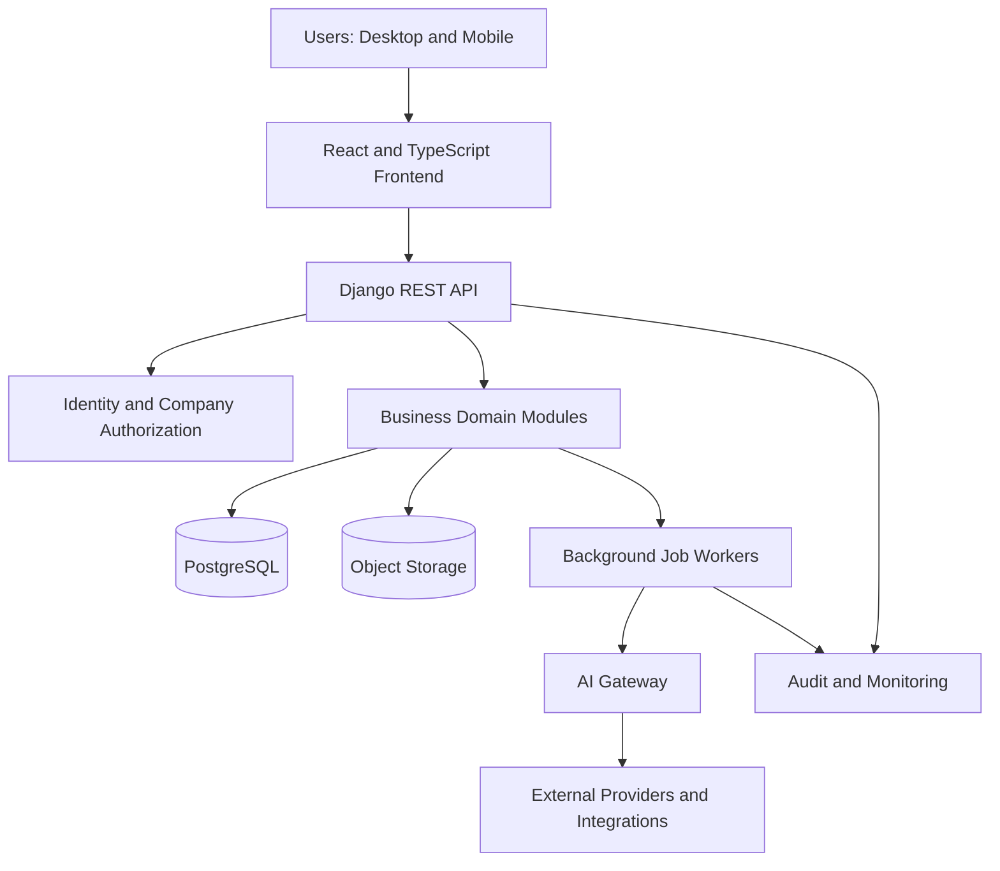
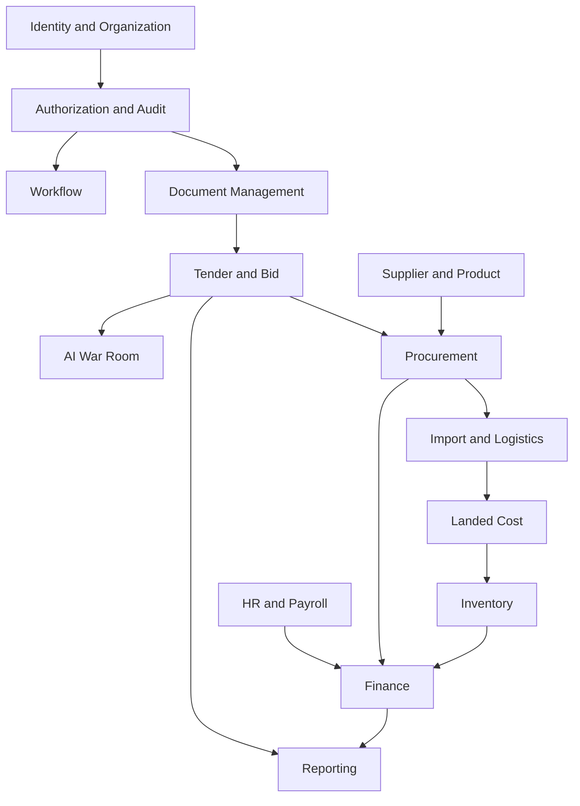
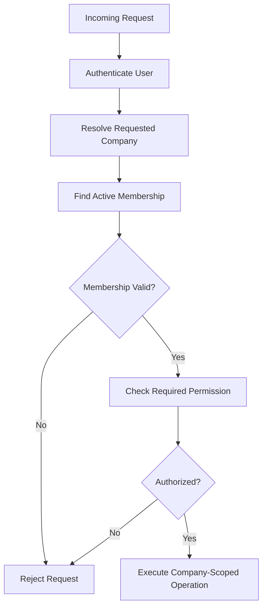
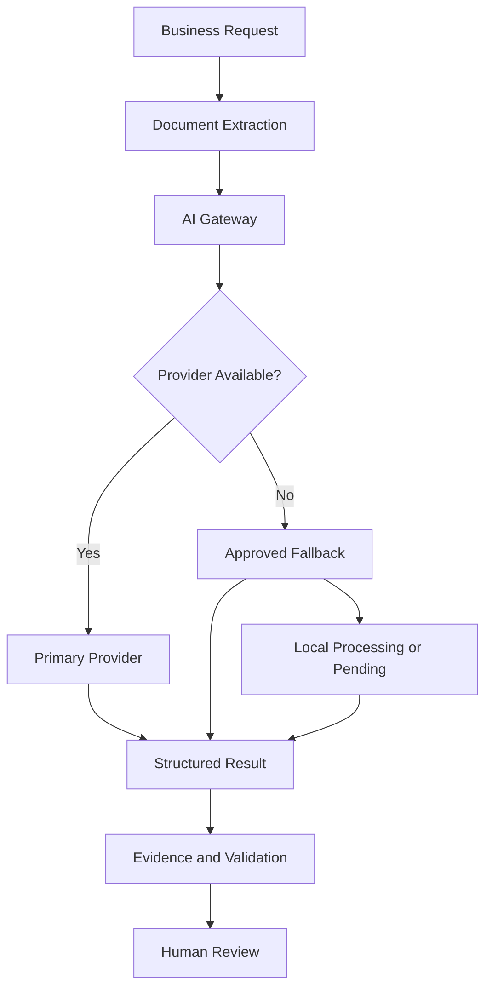

# INFINITY ERP NEXT
## Target System Architecture

**Document:** 03 — Target System Architecture  
**Version:** 1.0  
**Status:** Proposed architecture — subject to technical and business approval  
**Organization:** Infinity Investment Group  
**Initial companies:** YAH and CHI

---

# 1. PURPOSE

This document defines the proposed technical architecture of Infinity ERP Next.

It translates the Master Blueprint and Business Requirements into a coherent system design.

The architecture must provide:

- Secure multi-company operations.
- Reliable financial and operational records.
- Modular business capabilities.
- Evidence-based AI assistance.
- Maintainable application code.
- Controlled integrations.
- Safe migration from the existing ERP.
- Scalability without premature distributed-system complexity.

This document does not authorize changes to the existing production system.

# 2. ARCHITECTURE PRINCIPLES

## 2.1 Core principles

1. Security and company isolation by design.
2. Financial integrity before convenience.
3. Modular business domains with explicit ownership.
4. Server-side authorization for every protected operation.
5. Auditable changes to important business records.
6. Human approval for consequential decisions.
7. Provider-independent AI integration.
8. Reusable services instead of duplicated business logic.
9. API-first integration between frontend and backend.
10. Database integrity enforced through constraints and transactions.
11. Production and development environments remain isolated.
12. Migration is controlled, reconciled and reversible where practical.

## 2.2 Architecture style

<badge color="success">Proposed</badge> Modular monolith.

The initial implementation shall use a modular monolith rather than independently deployed microservices.

Reasons:

- Easier initial development and deployment.
- Strong transactional consistency.
- Lower infrastructure and operational costs.
- Clear separation of business domains.
- Easier debugging and maintenance.
- Ability to extract independent services later if justified.

Modules shall communicate through documented service interfaces and domain events, not unrestricted cross-module database manipulation.

# 3. HIGH-LEVEL SYSTEM ARCHITECTURE

The diagram represents logical responsibilities, not a requirement to deploy every component separately.

# 4. TECHNOLOGY STACK

## 4.1 Backend

Proposed:

- Python.
- Django.
- Django REST Framework.
- PostgreSQL.
- Database migrations.
- Explicit service and domain layers.
- Structured application logging.

Backend responsibilities:

- Business rules.
- Authorization.
- Validation.
- Database transactions.
- Financial calculations.
- Workflow enforcement.
- Audit events.
- Document metadata.
- Integration orchestration.

## 4.2 Frontend

Proposed:

- React.
- TypeScript.
- Responsive interface.
- API-driven data access.
- Reusable UI components.
- Centralized navigation and permission-aware actions.

Frontend responsibilities:

- Dashboards.
- Forms and data entry.
- Search and filtering.
- Document previews.
- Workflow interfaces.
- Approval screens.
- Reporting and visualizations.

Frontend visibility restrictions are not security controls. The backend must independently enforce every permission.

## 4.3 Database

Primary database:

- PostgreSQL.

Requirements:

- Transactional integrity.
- Foreign keys.
- Unique constraints.
- Indexes.
- Decimal arithmetic for financial amounts.
- Explicit company ownership.
- Controlled schema migrations.
- Backup and restore procedures.

Financial values must not rely on binary floating-point arithmetic.

## 4.4 Background processing

Proposed:

- Celery-compatible task processing.
- Redis or another approved broker/backend.
- Independent workers where operationally justified.

Suitable workloads:

- AI document processing.
- OCR.
- Report generation.
- Email and notification delivery.
- Scheduled reminders.
- Import and export jobs.
- Data migration jobs.

Background jobs must be durable, observable and safe against accidental duplicate execution.

## 4.5 File storage

Proposed:

- S3-compatible object storage or an approved equivalent.
- PostgreSQL stores document metadata and relationships.
- Object storage holds file content.

Requirements:

- Private by default.
- Authorized download.
- File checksums.
- Version history.
- Retention policies.
- Controlled upload validation.
- Backup and recovery.
- No permanent public document URLs for confidential records.

## 4.6 AI and document processing

The AI layer shall be provider-independent.

Potential integrations:

- Groq.
- OpenRouter.
- Gemini.
- Tavily for permitted live research.
- Local PDF and document extraction.
- OCR services or local OCR.

Provider availability, quotas, pricing and model suitability must be verified before implementation.

No provider shall be assumed to offer unlimited free service.

# 5. BACKEND DOMAIN ARCHITECTURE

The backend shall be organized around business domains.

Proposed domains:

| Domain | Primary responsibility |
|---|---|
| Identity | User identities, authentication and memberships |
| Organization | Companies, company settings and organizational structure |
| Authorization | Roles, permissions and access decisions |
| Tender | Opportunities, bids, lots and bid lifecycle |
| Workflow | Stages, transitions, approvals and delegation |
| AI War Room | AI analysis, evidence and generated artifacts |
| Supplier | Suppliers, manufacturers and qualification |
| Product | Product and technical specifications |
| Procurement | Requisitions, quotations and purchase orders |
| Import | Import files and customs processes |
| Landed Cost | Cost components, allocations and reconciliation |
| Logistics | Shipments, milestones and delivery |
| Inventory | Warehouses, stock movements and valuation |
| Sales | Customers, contracts and invoices |
| Finance | General ledger, AP, AR, cash and bank |
| HR | Employees, leave, attendance and payroll |
| Documents | Files, metadata, versions and retention |
| Collaboration | Tasks, comments, notifications and communication |
| Legal | Legal cases and correspondence |
| IT Service | IT tickets, assets and licenses |
| Reporting | KPIs, dashboards and governed reports |

Each domain should own its business rules and expose services to other domains.

# 6. MODULE DEPENDENCY MODEL

The dependency model is indicative. Detailed interfaces will be established during domain and database design.

# 7. APPLICATION LAYERS

## 7.1 Presentation layer

Contains:

- React pages.
- Shared components.
- Navigation.
- Forms.
- Dashboards.
- API client.
- Client-side state.

Must not contain authoritative financial calculations or permission decisions.

## 7.2 API layer

Contains:

- REST endpoints.
- Request validation.
- Authentication integration.
- Serialization.
- Response formatting.
- API versioning strategy.

Endpoints must enforce company context and permissions.

## 7.3 Application service layer

Coordinates business operations such as:

- Approving a purchase order.
- Submitting a bid.
- Posting a journal.
- Receiving inventory.
- Allocating landed cost.
- Closing a shipment.

Important operations should execute within appropriate database transactions.

## 7.4 Domain layer

Contains:

- Business entities.
- Domain rules.
- State transitions.
- Financial rules.
- Validation.
- Domain events.

Business rules must not be duplicated across API views, frontend components and background workers.

## 7.5 Infrastructure layer

Contains:

- Database repositories.
- Object storage.
- AI provider clients.
- Email integrations.
- Background job adapters.
- External APIs.
- Logging and monitoring.

Infrastructure details should not dictate business rules.

# 8. COMPANY CONTEXT AND AUTHORIZATION ARCHITECTURE

Every protected request must resolve:

1. Authenticated user.
2. Requested active company.
3. Valid active membership.
4. Required permission.
5. Record-level authorization.

Company context must be established and validated on the server.

A client-supplied company identifier is never sufficient authorization.

Proposed authorization flow:

Authorization rules:

- Company ADMIN is company-scoped.
- A role in YAH does not grant authority in CHI.
- Users may have different roles in different companies.
- Every query and write must enforce the applicable company scope.
- Background jobs must retain the initiating company and authorization context.
- System integrations must use explicitly scoped service identities.
- SUPERADMIN shall not be introduced.
- Unrestricted system-wide Django administrator access shall not be part of normal operations.

# 9. DATA AND TRANSACTION ARCHITECTURE

## 9.1 Data ownership

Each domain owns its business records.

Cross-domain operations should use documented application services.

Examples:

- Procurement requests inventory receipt through an inventory service.
- Inventory requests accounting valuation through finance services.
- HR requests payroll posting through finance services.
- Tender completion creates an authorized procurement handover.

## 9.2 Transaction rules

Use database transactions for critical operations.

Examples:

- Journal posting.
- Stock movement posting.
- Approval transitions.
- Purchase order issuance.
- Landed cost allocation.
- Payroll posting.

A failed critical transaction must not leave partially posted business records.

## 9.3 Financial precision

Use decimal data types.

Store:

- Original transaction amount.
- Currency.
- Functional currency amount.
- Exchange rate.
- Rate date and source.
- Rounding method.
- Relevant calculation basis.

Do not overwrite original transaction values when exchange rates change.

## 9.4 Audit records

Material business operations must capture:

- Actor.
- Company.
- Action.
- Entity type.
- Entity identifier.
- Timestamp.
- Relevant before and after values.
- Reason or approval reference where applicable.

Audit retention and protection against modification require a separate security design.

# 10. DOMAIN EVENT ARCHITECTURE

Events may be used to coordinate modules without tightly coupling them.

Examples:

- TenderSubmitted.
- TenderAwarded.
- PurchaseOrderApproved.
- GoodsReceived.
- ShipmentDispatched.
- ShipmentDelivered.
- LandedCostAllocated.
- JournalPosted.
- InvoiceApproved.
- PayrollPosted.

Requirements:

- Events must have unique identifiers.
- Consumers must handle duplicate delivery safely.
- Important events must not be lost when a database transaction succeeds.
- Use a transactional outbox pattern where reliable delivery is required.
- Events must not bypass authorization or approval rules.

# 11. AI GATEWAY ARCHITECTURE

All AI requests shall pass through one logical AI gateway.

Responsibilities:

- Provider selection.
- Model configuration.
- Quota awareness.
- Retry policy.
- Fallback policy.
- Request and response logging.
- Usage accounting.
- Error normalization.
- Prompt versioning.
- Evidence handling.

Proposed flow:

AI controls:

- Never invent missing prices, quantities or specifications.
- Preserve source document references.
- Identify uncertain extraction.
- Distinguish source facts from estimates and inference.
- Keep AI-generated outputs separate from approved business records.
- Require human approval for consequential actions.
- Stop repeated requests to providers that have exhausted quotas.
- Do not expose confidential documents to unapproved providers.

# 12. DOCUMENT PROCESSING ARCHITECTURE

Proposed processing pipeline:

1. Receive file.
2. Validate type and size.
3. Calculate checksum.
4. Store privately.
5. Create document metadata.
6. Extract text and tables where possible.
7. Run OCR if necessary.
8. Preserve page and source references.
9. Submit authorized content for AI analysis.
10. Validate structured output.
11. Store results and processing history.
12. Present for user review.

Original uploaded files must remain unchanged.

Extracted text and generated documents are separate artifacts.

# 13. API AND INTEGRATION ARCHITECTURE

## 13.1 API standards

Proposed:

- REST APIs.
- JSON request and response formats.
- Explicit API versioning.
- Standard validation errors.
- Pagination.
- Filtering and search.
- Consistent authentication.
- Rate limiting where appropriate.

## 13.2 Integration categories

Potential integrations:

- Email.
- External tender information sources.
- AI providers.
- OCR services.
- Banking and payment systems where available.
- Customs and logistics data sources where authorized.
- Document storage.
- Reporting exports.

Each integration requires:

- Business owner.
- Technical owner.
- Authentication method.
- Data classification.
- Error handling.
- Usage and cost controls.
- Audit requirements.

No external integration should be assumed available until verified.

# 14. REPORTING ARCHITECTURE

Reporting should use governed definitions.

Report categories:

- Executive performance.
- Tender pipeline.
- Bid performance.
- Procurement.
- Supplier performance.
- Import and shipment.
- Landed cost.
- Inventory.
- Receivables and payables.
- Cash flow.
- General ledger.
- HR and payroll.

Financial reports must use posted accounting records.

Reports must identify:

- Company scope.
- Reporting period.
- Currency.
- Data status.
- Calculation definition.

# 15. DEPLOYMENT ARCHITECTURE

Proposed logical environments:

| Environment | Purpose |
|---|---|
| Local development | Developer implementation |
| Integration/staging | Integration and acceptance |
| Production | Approved live business operations |

Deployment requirements:

- Separate environment configuration.
- Secrets stored outside source code.
- Controlled database migrations.
- Versioned releases.
- Health checks.
- Application logging.
- Background worker monitoring.
- Rollback strategy.
- Backup verification.

Production deployment must require explicit release authorization.

The new repository and existing production ERP must remain separate until an approved migration and cutover plan exists.

# 16. BACKUP AND DISASTER RECOVERY

The architecture must support:

- Automated database backups.
- Object storage backup or versioning.
- Backup encryption.
- Restricted backup access.
- Retention policy.
- Documented restoration procedure.
- Periodic restore exercises.
- Recovery point objective (RPO).
- Recovery time objective (RTO).

RPO and RTO values must be approved after infrastructure and business impact assessment.

A backup is not considered verified until restoration has been demonstrated.

# 17. OBSERVABILITY AND OPERATIONS

Operational monitoring should cover:

- Application errors.
- API latency.
- Database availability.
- Background job queues.
- Failed integrations.
- AI provider failures.
- Storage failures.
- Authentication anomalies.
- Permission denials.
- Backup status.

Logs must avoid exposing passwords, tokens, confidential document content and unnecessary personal information.

# 18. SCALABILITY AND PERFORMANCE

Initial architecture should prioritize correctness and maintainability.

Potential future improvements:

- Database indexing and query optimization.
- Read replicas.
- Caching.
- Independent worker scaling.
- Object storage lifecycle policies.
- Search infrastructure.
- Separate reporting workloads.
- Service extraction where justified.

Microservices must not be introduced merely for architectural appearance.

Any extraction must have a measurable operational or business justification.

# 19. SECURITY ARCHITECTURE REQUIREMENTS

The detailed security model will be specified in Document 5.

Architecture-level requirements include:

- Secure authentication.
- Membership-scoped authorization.
- Company-level data isolation.
- Secure file access.
- Encrypted transport.
- Protected secrets.
- Auditable privilege changes.
- Controlled service identities.
- Input validation.
- Secure background processing.
- Backup protection.
- Dependency and vulnerability management.

# 20. ARCHITECTURE DECISION REGISTER

| ID | Decision | Proposed direction | Status |
|---|---|---|---|
| ADR-001 | Application style | Modular monolith | Proposed |
| ADR-002 | Backend | Django and Django REST Framework | Proposed |
| ADR-003 | Frontend | React and TypeScript | Proposed |
| ADR-004 | Primary database | PostgreSQL | Proposed |
| ADR-005 | Authorization | Company membership and scoped permissions | Confirmed direction |
| ADR-006 | AI architecture | Provider-independent gateway | Confirmed direction |
| ADR-007 | File storage | Private object storage | Proposed |
| ADR-008 | Background processing | Durable worker architecture | Proposed |
| ADR-009 | Integration style | API and controlled domain events | Proposed |
| ADR-010 | Deployment | Separate development, staging and production | Proposed |
| ADR-011 | Financial integrity | Double-entry accounting and decimal precision | Required |
| ADR-012 | System-wide SUPERADMIN | Not introduced | Confirmed |

# 21. ARCHITECTURE RISKS

| Risk | Impact | Mitigation |
|---|---|---|
| Uncontrolled cross-module dependencies | High | Domain ownership and service interfaces |
| Company context bypass | Critical | Server-side authorization and isolation |
| Financial posting inconsistency | Critical | Transactions and ledger constraints |
| AI provider dependency | High | Gateway and quota-aware fallback |
| Duplicate background execution | High | Idempotency and durable task handling |
| File access exposure | Critical | Private storage and authorized downloads |
| Premature microservices | Medium | Modular monolith first |
| Migration incompatibility | Critical | Mapping and reconciliation before cutover |
| Unverified backup | Critical | Restore exercises |
| Uncontrolled production deployment | Critical | Explicit release authorization |

# 22. OPEN TECHNICAL DECISIONS

The following require confirmation before implementation:

1. Final hosting provider and infrastructure capacity.
2. PostgreSQL hosting and backup strategy.
3. Frontend deployment approach.
4. Object storage provider.
5. Background task broker and monitoring.
6. Authentication and MFA implementation.
7. AI provider availability and cost limits.
8. OCR engine and language support.
9. Email delivery provider.
10. Monitoring and error tracking solution.
11. Search engine requirements.
12. RPO and RTO targets.
13. API integration requirements.
14. Data residency and retention requirements.

# 23. ARCHITECTURE ACCEPTANCE CRITERIA

The architecture is ready for implementation approval when:

- All business modules have defined boundaries.
- Company authorization is a first-class architecture concern.
- Financial transactions have defined integrity controls.
- AI processing has evidence and human-review controls.
- Document processing has a secure lifecycle.
- Background work has failure and retry handling.
- Integration boundaries are documented.
- Deployment environments are separated.
- Backup and recovery requirements are agreed.
- Migration dependencies are understood.
- Critical architecture decisions have named owners and approval status.

# 24. NEXT DOCUMENTS

1. Database Entity and Relationship Design.
2. Security and Company Authorization Design.
3. UI and Navigation Blueprint.
4. AI Provider and Document Processing Design.
5. Data Migration Strategy.
6. Implementation Backlog.
7. Acceptance and Cutover Plan.

**Current status:** Proposed target architecture. Subject to technical review and business-owner approval.

