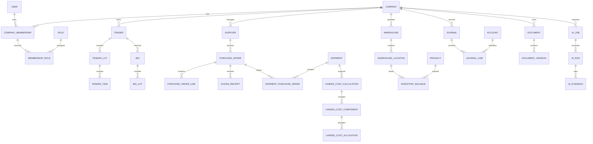

# DATABASE ENTITY AND RELATIONSHIP DESIGN

**Project:** Infinity ERP Next  
**Status:** Proposed — subject to technical and business approval  
**Database:** PostgreSQL  
**Architecture:** Modular monolith

---

# 1. PURPOSE

This document defines the proposed logical database structure for Infinity ERP Next.

It covers:

- Company and user identity.
- Membership-based authorization.
- Tender and bid management.
- Supplier and product management.
- Procurement and purchasing.
- Import, shipment and landed cost.
- Inventory and warehouse.
- Accounting and finance.
- Sales and contracts.
- HR and payroll.
- Workflow and approvals.
- Documents and records.
- AI and document intelligence.
- Communication and collaboration.
- Reporting and audit.

This is a proposed logical design, not an implemented database schema.

# 2. DATABASE DESIGN PRINCIPLES

## 2.1 Database platform

PostgreSQL is the proposed primary database.

Required capabilities:

- ACID transactions.
- Foreign-key constraints.
- Unique and check constraints.
- JSONB for selected flexible metadata.
- Full-text search.
- Reliable concurrent transactions.
- Indexing and query optimization.
- Backup and point-in-time recovery.

## 2.2 Data ownership

Each module owns its business entities.

Cross-module operations must use controlled application services and defined domain interfaces.

Every business transaction must have a clear company owner.

## 2.3 Financial precision

Proposed data types:

- Monetary amounts: NUMERIC(20,4).
- Exchange rates: NUMERIC(24,10).
- Quantities: NUMERIC(20,6).
- Percentages: NUMERIC(12,6).

Final precision and rounding policies require finance approval.

## 2.4 Historical integrity

Posted journals, inventory movements, approved documents and completed approval decisions must not be silently overwritten or deleted.

Corrections should use controlled reversal, adjustment or supersession records.

# 3. COMPANY, USER AND AUTHORIZATION ENTITIES

## 3.1 Company

Proposed entity: `Company`

Fields:

- id
- legal_name
- trading_name
- company_code
- registration_number
- tax_identification_number
- address
- country_id
- base_currency_id
- timezone
- contact_information
- status
- created_at
- updated_at

Rules:

- company_code must be unique.
- Legal identity fields require validation.
- Inactive companies retain historical records.

## 3.2 User

Proposed entity: `User`

Fields:

- id
- username
- email
- password_hash
- first_name
- last_name
- phone
- is_active
- last_login
- created_at
- updated_at

A user represents an individual identity and may belong to multiple companies.

A user account alone does not grant access to company records.

## 3.3 CompanyMembership

Proposed entity: `CompanyMembership`

Fields:

- id
- company_id
- user_id
- employee_id (optional)
- membership_status
- joined_at
- ended_at
- created_at
- updated_at

Rules:

- A user may have memberships in multiple companies.
- Duplicate active memberships for the same user and company are prohibited.
- Membership status must be checked before granting company access.
- Company access must always be validated against the active membership.

## 3.4 Roles and permissions

Proposed entities:

- Role
- Permission
- RolePermission
- MembershipRoleAssignment
- MembershipPermissionOverride (optional)

Example company roles:

- ADMIN
- MANAGER
- FINANCE
- PROCUREMENT
- TENDER
- WAREHOUSE
- HR
- AUDITOR
- EMPLOYEE

A role assignment must reference a company membership.

Roles and permissions must be company-scoped.

No SUPERADMIN role or unrestricted system-wide administrator is proposed.

## 3.5 Company configuration

Proposed entities:

- CompanySetting
- CompanyNumberSequence
- CompanyFiscalConfiguration
- CompanyApprovalPolicy
- CompanyDocumentPolicy
- CompanyBranch
- CompanyDepartment

Each company configuration must have explicit ownership.

# 4. COMMON REFERENCE DATA

Proposed entities:

- Currency
- ExchangeRate
- Country
- Region
- City
- UnitOfMeasure
- UnitConversion
- TaxCode
- PaymentTerm
- Incoterm
- DocumentType
- BusinessCategory
- ProductCategory
- CostCenter
- Project
- Branch
- Warehouse

Reference data may be global or company-specific.

Company-specific reference records must carry company ownership.

Global reference data must not expose company-private business information.

# 5. TENDER AND BID MANAGEMENT

## 5.1 Tender

Proposed entity: `Tender`

Fields:

- id
- company_id
- tender_reference
- title
- procuring_entity
- country_id
- publication_date
- submission_deadline
- tender_type
- source
- estimated_value
- currency_id
- status
- assigned_membership_id
- created_at
- updated_at

A tender belongs to one company.

Tender references should be unique within the owning company.

## 5.2 Tender lots and items

Proposed entities:

- TenderLot
- TenderItem

Relationships:

- One Tender has many TenderLots.
- One TenderLot has many TenderItems.

TenderItem fields:

- id
- company_id
- tender_lot_id
- item_number
- description
- specification
- quantity
- unit_of_measure_id
- estimated_unit_price
- currency_id

## 5.3 Bid management

Proposed entities:

- Bid
- BidLot
- BidDocument
- BidDocumentVersion
- BidSubmission
- BidEvaluation
- TechnicalEvaluation
- CommercialEvaluation
- ComplianceChecklist
- EvaluationCriterion
- EvaluationResult
- TenderClarification
- TenderAward
- TenderAwardLot

Relationships:

- One Tender may have multiple bids.
- One Bid may include multiple lots.
- One lot may be associated with multiple bids.
- One BidDocument may have multiple versions.
- One Tender may have multiple evaluation records.
- One TenderAward may include multiple awarded lots.

Bid document versions must preserve:

- Version number.
- File reference.
- Checksum.
- Created by membership.
- Creation timestamp.
- Approval status.
- Superseded version reference.

Submitted or approved versions must not be silently replaced.

# 6. WORKFLOW AND APPROVAL MANAGEMENT

Proposed entities:

- WorkflowDefinition
- WorkflowVersion
- WorkflowInstance
- WorkflowStep
- WorkflowTask
- WorkflowTransition
- ApprovalRequest
- ApprovalDecision
- ApprovalDelegation
- WorkflowComment
- WorkflowHistory

Relationships:

- One workflow definition has multiple versions.
- One workflow instance uses one workflow version.
- One workflow instance has multiple steps.
- One approval request may have multiple decisions.
- Each decision identifies the acting company membership.

Preserve:

- Previous status.
- New status.
- Acting membership.
- Timestamp.
- Decision.
- Reason.
- Supporting documents.

Existing workflow identifiers T02–T24 and I01–I16 must remain traceable until their exact meanings and mappings are validated.

# 7. SUPPLIER AND PRODUCT MANAGEMENT

## 7.1 Supplier

Proposed entity: `Supplier`

Fields:

- id
- company_id
- supplier_code
- legal_name
- trading_name
- country_id
- address
- tax_number
- registration_number
- payment_terms_id
- default_currency_id
- status

Related entities:

- SupplierContact
- SupplierAddress
- SupplierBankAccount
- SupplierDocument
- SupplierQualification
- SupplierEvaluation
- SupplierCategory
- SupplierProduct
- SupplierCommunication

Supplier banking information requires restricted access and audit history.

## 7.2 Product

Proposed entity: `Product`

Fields:

- id
- company_id (nullable only if shared catalog is approved)
- product_code
- name
- description
- category_id
- brand
- manufacturer_id
- unit_of_measure_id
- technical_specification
- status

Related entities:

- ProductCategory
- ProductSpecification
- ProductAttribute
- ProductDocument
- ProductManufacturer
- ProductAlternative
- ProductPriceHistory
- ProductUnitConversion

Shared product catalog behavior requires an explicit ownership decision.

# 8. PROCUREMENT AND PURCHASING

Proposed entities:

- PurchaseRequisition
- PurchaseRequisitionLine
- PurchaseRequest
- SupplierQuotation
- SupplierQuotationLine
- QuotationComparison
- PurchaseOrder
- PurchaseOrderLine
- PurchaseOrderAmendment
- GoodsReceipt
- GoodsReceiptLine
- SupplierInvoice
- SupplierInvoiceLine
- PurchaseReturn
- ProcurementApproval

Relationships:

- One supplier has many purchase orders.
- One purchase order has many lines.
- One purchase order may have multiple goods receipts.
- One purchase order may have multiple amendments.
- Supplier invoices may reference purchase order and receipt lines.

Procurement approval and financial posting must be separate controlled operations.

All purchasing transactions must retain company ownership.

# 9. IMPORT AND INTERNATIONAL TRADE

## 9.1 Shipment

Proposed entity: `Shipment`

A shipment must not be restricted to one tender or one purchase order.

Proposed relationships:

- One company has many shipments.
- One purchase order may be fulfilled through multiple shipments.
- One shipment may contain lines from multiple purchase orders, subject to approved business rules.
- One shipment may contain multiple containers.
- One shipment may have multiple logistics events.

## 9.2 Shipment entities

- Shipment
- ShipmentPurchaseOrder
- ShipmentLine
- ShipmentContainer
- ShipmentDocument
- ShipmentMilestone
- ShipmentEvent
- FreightBooking
- FreightCharge
- CustomsDeclaration
- CustomsAssessment
- InsurancePolicy
- PortCharge
- ClearingCharge
- DeliveryOrder
- ShipmentTrackingEvent

Potential milestones:

- Supplier readiness.
- Cargo pickup.
- Export clearance.
- Vessel departure.
- Transshipment.
- Arrival.
- Customs clearance.
- Port release.
- Inland transport.
- Warehouse delivery.

Milestone requirements depend on transport mode and company procedures.

# 10. LANDED COST MANAGEMENT

Proposed entities:

- LandedCostCalculation
- LandedCostComponent
- LandedCostAllocation
- LandedCostAdjustment
- LandedCostApproval
- LandedCostEvidence
- LandedCostItemResult

Potential cost categories:

- Product purchase cost.
- International freight.
- Insurance.
- Export charges.
- Customs duty.
- Import tax.
- Port charges.
- Clearing charges.
- Inland transport.
- Inspection.
- Bank charges.
- Other approved costs.

Potential allocation methods:

- Value.
- Quantity.
- Weight.
- Volume.
- Equal allocation.
- Direct item allocation.
- Custom approved allocation.

Every cost allocation must preserve:

- Source amount.
- Source currency.
- Exchange rate.
- Base currency amount.
- Allocation method.
- Allocated amount.
- Rounding difference.
- Evidence.
- Approval status.

Do not automatically remove suspected duplicate costs or exclude costs with uncertain inclusion.

Potential duplicates, unknown inclusions and exclusions must be flagged for human review.

Original inputs and adjustment history must be retained.

# 11. INVENTORY AND WAREHOUSE

## 11.1 Warehouse entities

- Warehouse
- WarehouseZone
- WarehouseLocation
- StorageBin
- WarehouseAccessAssignment

One company may operate multiple warehouses.

## 11.2 Inventory entities

- InventoryItem
- InventoryBalance
- InventoryMovement
- InventoryMovementLine
- StockReservation
- StockTransfer
- StockTransferLine
- StockCount
- StockCountLine
- StockAdjustment
- InventoryValuation
- InventoryValuationLayer
- InventorySerialNumber
- InventoryBatch
- InventoryLot

Inventory movements must preserve:

- Company.
- Product.
- Source location.
- Destination location.
- Quantity.
- Unit of measure.
- Movement type.
- Reference transaction.
- Posting status.
- Responsible membership.
- Timestamp.

Posted inventory movements must not be silently edited or deleted.

## 11.3 Inventory valuation

Potential methods:

- FIFO.
- Weighted average.
- Specific identification.

The final valuation policy requires accounting approval.

# 12. ACCOUNTING AND FINANCE

The proposed finance design uses double-entry accounting.

This database design does not itself approve accounting policies, tax treatment or statutory reporting rules.

## 12.1 Chart of accounts

Proposed entities:

- Account
- AccountGroup
- AccountType
- AccountHierarchy
- CompanyAccountMapping

Each company must have an approved chart of accounts or approved group mapping.

## 12.2 Fiscal configuration

Proposed entities:

- FiscalYear
- FiscalPeriod
- AccountingCalendar
- PeriodClosing
- PeriodReopeningApproval

Posted entries must respect approved fiscal-period controls.

## 12.3 General ledger

Proposed entities:

- Journal
- JournalLine
- JournalSource
- JournalApproval
- JournalReversal
- JournalAttachment

Journal fields:

- id
- company_id
- journal_number
- journal_date
- fiscal_period_id
- currency_id
- exchange_rate
- source_module
- source_reference
- status
- created_by_membership_id
- posted_by_membership_id
- posted_at

JournalLine fields:

- id
- journal_id
- account_id
- description
- debit_amount
- credit_amount
- transaction_currency
- base_currency_debit
- base_currency_credit
- cost_center_id
- project_id
- supplier_id (optional)
- customer_id (optional)

Required controls:

- Posted journals must balance.
- Posted journals cannot be silently changed.
- Reversals must reference original journals.
- Posting must occur in an open accounting period.
- Posting must be atomic.
- Financial amounts must use decimal precision.

## 12.4 Accounts payable

Proposed entities:

- AccountsPayable
- SupplierInvoice
- SupplierInvoiceLine
- SupplierCreditNote
- SupplierPayment
- SupplierPaymentAllocation
- PaymentBatch
- PaymentApproval

## 12.5 Accounts receivable

Proposed entities:

- Customer
- CustomerContact
- CustomerContract
- CustomerInvoice
- CustomerInvoiceLine
- CustomerCreditNote
- CustomerReceipt
- CustomerReceiptAllocation
- CollectionActivity

## 12.6 Banking and cash

Proposed entities:

- BankAccount
- BankTransaction
- BankStatement
- BankStatementLine
- BankReconciliation
- BankReconciliationMatch
- CashAccount
- CashTransaction
- CashTransfer
- PaymentInstruction

## 12.7 Budget and cost management

Proposed entities:

- Budget
- BudgetVersion
- BudgetLine
- BudgetApproval
- CostCenter
- Project
- CostAllocation
- ExpenseClaim
- ExpenseClaimLine
- PettyCashAccount
- PettyCashTransaction

## 12.8 Multi-currency

Financial records must preserve:

- Transaction currency.
- Transaction amount.
- Exchange rate.
- Rate date.
- Base currency.
- Base currency amount.
- Exchange rate source.
- Rounding difference.

Exchange rates must be historically preserved.

# 13. SALES, CONTRACTS AND CUSTOMERS

Proposed entities:

- Customer
- CustomerContact
- CustomerAddress
- CustomerQualification
- SalesOpportunity
- SalesQuotation
- SalesQuotationLine
- SalesOrder
- SalesOrderLine
- CustomerContract
- ContractMilestone
- Delivery
- DeliveryLine
- CustomerInvoice
- CustomerReceipt

A tender award may lead to one or more customer contracts according to approved business rules.

All sales and contract records must retain company ownership.

# 14. HR AND PAYROLL

Proposed entities:

- Employee
- EmployeeCompanyAssignment
- Department
- Position
- EmploymentContract
- EmployeeDocument
- LeaveType
- LeaveBalance
- LeaveRequest
- AttendanceRecord
- WorkSchedule
- OvertimeRequest
- PayrollPeriod
- PayrollRecord
- PayrollComponent
- PayrollLine
- PayrollAdjustment
- PayrollApproval
- PerformanceReview
- TrainingRecord
- EmployeeDisciplinaryRecord

Employee identity and company employment assignment should be separate concepts.

Payroll records require restricted company-scoped access.

Tax, statutory deductions and payroll policies require jurisdiction-specific validation.

# 15. TASKS AND COLLABORATION

Proposed entities:

- Task
- TaskAssignment
- TaskComment
- TaskAttachment
- TaskHistory
- TaskDependency
- Notification
- NotificationPreference
- ChatRoom
- ChatRoomMembership
- ChatMessage
- MessageAttachment
- Memo
- MemoRecipient
- Meeting
- MeetingParticipant
- CalendarEvent
- ActivityFeedEntry

Task assignments should reference company memberships.

Company-owned communications must not leak across company boundaries.

# 16. DOCUMENT AND RECORDS MANAGEMENT

Proposed entities:

- Document
- DocumentVersion
- DocumentCategory
- DocumentType
- DocumentFolder
- DocumentFolderMembership
- DocumentLink
- DocumentAccessPolicy
- DocumentApproval
- DocumentRetentionPolicy
- DocumentClassification
- DocumentAuditEvent
- DocumentChecksum

Document metadata should include:

- Company.
- Document type.
- Business reference.
- File storage key.
- Original filename.
- MIME type.
- File size.
- Checksum.
- Version number.
- Created by membership.
- Creation timestamp.
- Classification.
- Retention status.

File content should normally be stored in approved object storage rather than relational database rows.

A controlled DocumentLink entity may connect a document to multiple business records.

Document access must validate both company ownership and business-record permissions.

# 17. AI AND DOCUMENT INTELLIGENCE

Proposed entities:

- AIProvider
- AIModel
- AIProviderConfiguration
- AIUsagePolicy
- AIJob
- AIRun
- AIPromptTemplate
- AIPromptVersion
- AIResponse
- AIEvidence
- AIResearchSource
- AIExtractionResult
- AIReview
- AIApproval
- AIArtifact
- AIArtifactVersion
- AIUsageRecord
- AIQuotaSnapshot
- AIErrorLog

AI execution records should preserve:

- Company.
- Requesting membership.
- Provider.
- Model.
- Prompt version.
- Input reference.
- Output reference.
- Usage information where available.
- Cost or quota consumption where available.
- Execution status.
- Timestamp.
- Error details.
- Evidence references.
- Human review status.

AI-generated financial or compliance conclusions must not automatically become approved business records.

Provider credentials must be kept in approved secrets management, not ordinary database records.

# 18. LEGAL AND CORPORATE ADMINISTRATION

Proposed entities:

- LegalCase
- LegalCaseParty
- LegalCaseEvent
- LegalCaseDocument
- Correspondence
- CorrespondenceRecipient
- CorrespondenceAttachment
- Contract
- ContractVersion
- ContractObligation
- ContractRenewal
- VisitorLog
- CourierDispatch
- CourierTrackingEvent
- CompanyResource
- ResourceAssignment
- ResourceMaintenance
- CorporateDecision
- BoardMeeting
- BoardResolution

Legal and corporate records require restricted access and appropriate audit history.

# 19. IT SERVICE AND ASSET MANAGEMENT

Proposed entities:

- ITAsset
- ITAssetCategory
- ITAssetAssignment
- ITTicket
- ITTicketComment
- ITTicketAttachment
- ITTicketHistory
- ITService
- ITChangeRequest
- ITChangeApproval
- ITMaintenanceRecord
- SoftwareLicense
- LicenseAssignment
- ITKnowledgeArticle

IT assets may be assigned to employees or company locations.

# 20. REPORTING AND BUSINESS INTELLIGENCE

Proposed entities:

- ReportDefinition
- ReportVersion
- ReportExecution
- ReportSchedule
- DashboardDefinition
- DashboardWidget
- KPI
- KPIValue
- DataSnapshot
- ExportJob
- AnalyticsAccessLog

Reporting should use approved query services, reporting views or controlled analytical models.

Heavy analytical queries must not compromise operational transaction performance.

## 20.1 Group-reporting authorization entities

The following proposed entities provide a separate authorization model
for consolidated group reporting.

### GroupReportingGrant

Represents an explicit, revocable authorization for a user to access
approved consolidated reporting.

Proposed attributes:

- id
- user_id
- status
- valid_from
- valid_until
- business_justification
- approval_reference
- granted_by_user_id
- approved_at
- created_at
- updated_at
- revoked_at
- revoked_by_user_id
- revocation_reason

A grant must have an identifiable recipient, authorized grantor,
approval reference, effective period and status.

The lifecycle must distinguish pending, active, suspended, expired
and revoked states. Approval must be performed by an authorized
approver other than the grant recipient or original requester.
Only an approved grant within its effective period may become active.

### GroupReportingGrantCompany

Defines the exact companies covered by a grant.

Proposed attributes:

- id
- group_reporting_grant_id
- company_id
- created_at

Each grant must explicitly list its permitted companies. A company
not listed in this entity is outside the grant's authorization scope.

### GroupReportingGrantReportScope

Defines which reporting capabilities are permitted by a grant.

Proposed attributes:

- id
- group_reporting_grant_id
- report_definition_id
- permitted_metrics
- permitted_data_categories
- aggregation_level
- created_at

Only approved report definitions, metrics and data categories may
be exposed through the grant.

The aggregation level must be restricted to approved aggregate
outputs, such as summaries and grouped totals. Its allowed values
must be defined by the reporting policy and must exclude row-level,
transaction-level and identifiable-record output. Row-level records,
individual transactions, identifiable source records and operational
drill-down must not be authorized by this entity. Any minimum group-size
or disclosure-control threshold must follow the approved reporting
policy.

### Entity constraints and authorization rules

- GroupReportingGrant references User, not CompanyMembership.
- Grant creation and approval must be attributable to authorized
  users and recorded in the audit trail.
- GroupReportingGrantCompany must have a unique constraint on
  (group_reporting_grant_id, company_id).
- GroupReportingGrantReportScope must prevent duplicate scope
  entries for the same grant and report definition.
- Company scope must be checked against active companies and the
  approved grant scope before report execution.
- Grant status and validity dates must be checked at execution time.
- Expired, suspended or revoked grants must not authorize new
  report executions or exports.
- A grant must not create or modify CompanyMembership,
  MembershipRoleAssignment, RolePermission or operational records.
- Group-reporting permission remains a separate permission check;
  permission assignment alone does not create a reporting grant.
- Generated reports, snapshots, exports and scheduled jobs must
  retain the applicable grant and company-scope references so that
  access can be revalidated.
- Grant creation, approval, modification, expiry, revocation,
  execution and denied access must be recorded through the existing
  AuditLog and SecurityEvent mechanisms.

These entities define a logical data model. Physical field types,
foreign-key behavior, indexes and retention rules must be finalized
during detailed schema design.

# 21. AUDIT AND SYSTEM CONTROL

Proposed entities:

- AuditLog
- SecurityEvent
- LoginEvent
- AccessAttempt
- DataChangeEvent
- IntegrationEvent
- OutboxEvent
- BackgroundJob
- BackgroundJobAttempt
- SystemConfigurationChange

Audit records should capture:

- Company context.
- Acting user and membership.
- Action.
- Entity type and identifier.
- Timestamp.
- Relevant before/after values.
- Request correlation identifier.
- Source or channel.
- Outcome.

Passwords, access tokens and secrets must never be copied into audit payloads.

Audit records must be protected against unauthorized modification.

# 22. KEY RELATIONSHIPS

## 22.1 Identity

- Company 1:N CompanyMembership.
- User 1:N CompanyMembership.
- CompanyMembership 1:N MembershipRoleAssignment.
- Role 1:N RolePermission.
- Permission 1:N RolePermission.
- Company 1:N CompanySetting.

## 22.2 Tender

- Company 1:N Tender.
- Tender 1:N TenderLot.
- TenderLot 1:N TenderItem.
- Tender 1:N Bid.
- Bid 1:N BidLot.
- TenderLot 1:N BidLot.
- Bid 1:N BidDocument.
- BidDocument 1:N BidDocumentVersion.

## 22.3 Procurement and import

- Supplier 1:N PurchaseOrder.
- PurchaseOrder 1:N PurchaseOrderLine.
- PurchaseOrder 1:N GoodsReceipt.
- PurchaseOrder 1:N ShipmentPurchaseOrder.
- Shipment 1:N ShipmentPurchaseOrder.
- Shipment 1:N ShipmentContainer.
- Shipment 1:N ShipmentEvent.
- Shipment 1:N LandedCostCalculation.
- LandedCostCalculation 1:N LandedCostComponent.
- LandedCostComponent 1:N LandedCostAllocation.

## 22.4 Inventory

- Company 1:N Warehouse.
- Warehouse 1:N WarehouseLocation.
- Product 1:N InventoryBalance.
- WarehouseLocation 1:N InventoryBalance.
- InventoryMovement 1:N InventoryMovementLine.

## 22.5 Finance

- Company 1:N Journal.
- FiscalPeriod 1:N Journal.
- Journal 1:N JournalLine.
- Account 1:N JournalLine.
- Supplier 1:N SupplierInvoice.
- SupplierInvoice 1:N SupplierInvoiceLine.
- SupplierPayment 1:N SupplierPaymentAllocation.
- CustomerInvoice 1:N CustomerInvoiceLine.
- CustomerReceipt 1:N CustomerReceiptAllocation.

## 22.6 Documents and AI

- Company 1:N Document.
- Document 1:N DocumentVersion.
- Document 1:N DocumentLink.
- AIJob 1:N AIRun.
- AIRun 1:N AIEvidence.
- AIRun 1:N AIResponse.
- AIArtifact 1:N AIArtifactVersion.

## 22.7 Group reporting

- User 1:N GroupReportingGrant as grant recipient.
- User 1:N GroupReportingGrant as grantor.
- User 1:N GroupReportingGrant as revoking user.
- GroupReportingGrant 1:N GroupReportingGrantCompany.
- Company 1:N GroupReportingGrantCompany.
- GroupReportingGrant 1:N GroupReportingGrantReportScope.
- ReportDefinition 1:N GroupReportingGrantReportScope.

GroupReportingGrantCompany is the explicit company-scope
relationship. GroupReportingGrantReportScope defines the permitted
reporting scope. Neither relationship creates company membership
or operational permissions.

# 23. SIMPLIFIED ENTITY RELATIONSHIP DIAGRAM

This diagram illustrates selected relationships, not the complete physical schema.

# 24. COMPANY ISOLATION AND DATA OWNERSHIP

Every company-owned transactional entity must have an explicit company ownership path.

Recommended controls:

- Company-scoped service-layer querysets.
- Active membership validation.
- Company-scoped permission checks.
- Composite unique constraints where appropriate.
- Composite foreign keys where practical.
- PostgreSQL row-level security where approved.
- Audit events for privileged operations.

Cross-company references are prohibited by default.

A company must not access another company's:

- Tender records.
- Supplier transactions.
- Purchase orders.
- Shipment documents.
- Inventory balances.
- Financial records.
- Employee information.
- AI evidence.
- Private correspondence.

Shared reference data requires an explicit ownership and access policy.

Application-level filtering alone must not be assumed sufficient.

# 25. CONSTRAINTS AND INDEXES

Potential unique constraints:

- Company.company_code.
- User.username.
- CompanyMembership(company_id, user_id).
- Company-scoped tender references.
- Company-scoped purchase order numbers.
- Company-scoped journal numbers.
- Company-scoped supplier codes where required.
- Company-scoped product codes where required.
- Document version numbers within their parent document.

Potential indexes:

- Frequently queried foreign keys.
- company_id and status.
- company_id and created_at.
- company_id and business reference.
- Tender submission deadlines.
- Purchase order status and date.
- Shipment status and estimated arrival.
- Inventory product and warehouse location.
- Journal date and fiscal period.
- Supplier and customer invoice due dates.
- Document business references.
- Workflow status and assigned membership.
- AI job status and creation time.

Final indexes must be based on actual query patterns and performance measurements.

# 26. DELETION AND ARCHIVAL

Hard deletion must be restricted for:

- Posted journals.
- Inventory movements.
- Approval decisions.
- Audit logs.
- Submitted tender documents.
- Approved contracts.
- Payroll records.
- Statutory records.
- Legally relevant correspondence.

Eligible master records may use soft deletion:

- is_deleted
- deleted_at
- deleted_by_membership_id
- deletion_reason

Soft deletion must not hide records needed for audit, reconciliation or statutory retention.

Retention periods require legal and business approval.

# 27. TRANSACTIONAL INTEGRITY

Critical operations must execute within database transactions.

Examples:

- Journal posting.
- Inventory receipt.
- Inventory transfer.
- Inventory adjustment.
- Supplier payment allocation.
- Customer receipt allocation.
- Purchase order approval.
- Landed cost approval.
- Tender submission.
- Workflow approval.

Cross-module operations should use controlled domain services.

A transactional outbox may be used for reliable event publication.

Background jobs must be idempotent where retries are possible.

# 28. MIGRATION FROM THE EXISTING ERP

The existing source-code inspection identified approximately 40 model classes in `core/models.py`.

This is a source-code inventory, not a verified production database inventory.

Existing models identified:

1. Company
2. Employee
3. CompanyMembership
4. MembershipRole
5. CompanyRoleAssignment
6. Task
7. Notification
8. AuditLog
9. Memo
10. TaskComment
11. TaskHistory
12. ChatRoom
13. ChatMessage
14. Tender
15. TenderReview
16. TenderLot
17. LotItem
18. BidDocumentVersion
19. WarRoomArtifact
20. Document
21. CompanyResource
22. EmployeeDocument
23. Correspondence
24. LegalCase
25. CompanySetting
26. CourierDispatch
27. SupplyRequest
28. VisitorLog
29. LeaveRequest
30. ExpenseRequest
31. CashFlowEntry
32. PayrollRecord
33. PerformanceReview
34. Supplier
35. Shipment
36. InventoryItem
37. Product
38. StockTransaction
39. ITTicket
40. PasswordResetCode

## 28.1 Migration requirements

- Preserve source identifiers where appropriate.
- Maintain legacy-to-new identifier mappings.
- Preserve reliable timestamps.
- Preserve document references and checksums.
- Preserve approval and workflow history.
- Reconcile financial balances.
- Reconcile inventory quantities and valuation.
- Preserve company membership history.
- Validate user and employee mappings.
- Record unresolved and ambiguous mappings.
- Never silently discard source data.
- Never automatically merge uncertain duplicates.

## 28.2 Special migration considerations

**Employee and membership:** Separate user identity, employment and company membership while preserving validated relationships.

**Tender and bid:** Map Tender, TenderLot, LotItem and BidDocumentVersion to the new tender and bid structures.

**Shipment:** Inspect existing relationships before mapping. The proposed design supports multiple shipments against purchasing transactions.

**Inventory:** Reconcile InventoryItem, Product and StockTransaction before migration to the new warehouse, movement and valuation structure.

**Finance:** Existing CashFlowEntry, ExpenseRequest and PayrollRecord do not establish that a complete double-entry ledger exists. Opening balances and historical transactions require finance reconciliation.

**Documents and AI:** Preserve Document, BidDocumentVersion and WarRoomArtifact records, files and source references.

**Workflow:** Preserve existing task, workflow and approval history. Keep T02–T24 and I01–I16 traceable.

## 28.3 Migration stages

1. Inspect production schema and migrations.
2. Confirm business ownership and company boundaries.
3. Extract data through approved read-only procedures.
4. Profile data quality.
5. Define source-to-target mapping.
6. Identify duplicates and unresolved records.
7. Build migration scripts in a non-production environment.
8. Perform trial migration.
9. Reconcile finance, inventory and documents.
10. Obtain business-owner acceptance.
11. Prepare cutover and rollback plans.
12. Execute only after explicit authorization.

This document does not authorize production database changes.

# 29. SECURITY AND PRIVACY

- Enforce company ownership on every business operation.
- Validate active membership before access.
- Apply role and permission checks at the service layer.
- Restrict payroll and employee information.
- Restrict banking and payment information.
- Protect legal and confidential documents.
- Encrypt sensitive data in transit and at rest.
- Use secure secrets management.
- Audit privileged access.
- Prevent unauthorized cross-company exports.
- Restrict AI provider access to approved data.
- Define retention and deletion controls.
- Never store plaintext passwords or API credentials.

Company ADMIN remains company-scoped.

No unrestricted system-wide administrator or SUPERADMIN is proposed.

# 30. OPEN DESIGN DECISIONS

The following decisions require validation:

1. Shared versus company-specific product catalogs.
2. Shared versus company-specific supplier records.
3. Company and branch hierarchy.
4. Chart-of-accounts structure.
5. Base and functional currency rules.
6. Fiscal year and accounting period policies.
7. Tax and statutory requirements.
8. Inventory valuation method.
9. Negative inventory policy.
10. Warehouse and bin tracking.
11. Batch and serial tracking.
12. Landed cost allocation policy.
13. Supplier invoice matching rules.
14. Revenue recognition policy.
15. Document retention requirements.
16. AI evidence retention.
17. Cross-company transaction rules.
18. Intercompany accounting.
19. Archival and legal hold policy.
20. PostgreSQL row-level security adoption.

# 31. ACCEPTANCE CRITERIA

The design is ready for detailed implementation only when:

- All 20 module domains have validated entity ownership.
- Company isolation rules are approved.
- User and membership relationships are approved.
- Key relationships are reviewed.
- Financial ledger structure is approved by finance.
- Inventory valuation rules are approved.
- Landed cost allocation rules are approved.
- Tender and workflow mappings are validated.
- Document and AI retention is defined.
- Migration mappings are reviewed.
- Security and audit requirements are accepted.
- Open decisions are resolved or formally deferred.

# 32. DOCUMENT STATUS

**Current status:** Proposed logical database design.

Not yet approved or implemented:

- Physical PostgreSQL schema.
- Django model definitions.
- Database migrations.
- Accounting policies.
- Tax configuration.
- Inventory valuation policies.
- Company data-sharing policies.
- Production migration procedures.

**Next document:** Security and Company Authorization Design.

