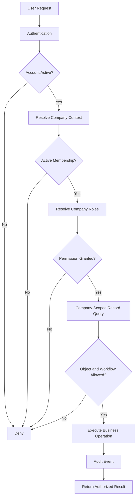

# SECURITY AND COMPANY AUTHORIZATION DESIGN

**Project:** Infinity ERP Next  
**Document:** Security and Company Authorization Design  
**Version:** 1.0  
**Status:** Proposed design — subject to business-owner and technical approval  
**Date:** 12 November 2026

---

# 1. PURPOSE

This document defines the security architecture, identity management,
company isolation, role-based access control, authorization policies,
audit requirements, and security governance for Infinity ERP Next.

The objective is to establish a secure multi-company ERP in which
employees and authorized users can access only the companies, modules,
records, and operations permitted by their active company memberships.

Security must be enforced by the backend, not merely by hiding interface
elements.

# 2. SECURITY DESIGN PRINCIPLES

The system SHALL follow these principles:

1. Deny access by default.
2. Authenticate every protected request.
3. Authorize every protected business operation.
4. Enforce company isolation at the backend.
5. Associate company roles with explicit company memberships.
6. Apply least-privilege access.
7. Separate authentication from authorization.
8. Record security-sensitive actions in an audit trail.
9. Protect financial, employee, procurement, tender, and confidential data.
10. Validate uploaded files and external integrations.
11. Avoid implicit trust based on user identity or interface visibility.
12. Preserve evidence of approvals and authorization decisions.
13. Apply consistent policies across web pages, APIs, exports, and background jobs.
14. Never treat a Django system-wide administrator as an ordinary business role.
15. Require explicit authorization for security configuration changes.

# 3. COMPANY STRUCTURE

## 3.1 Initial companies

The initial organization includes:

- YAH
- CHI

The architecture must support additional companies without requiring
a redesign of the authorization model.

## 3.2 Company isolation

Each company is an independent authorization boundary.

A user may belong to one or more companies, but membership in one
company does not automatically grant access to another.

Examples:

- A YAH employee cannot access CHI records without CHI membership.
- A CHI ADMIN cannot administer YAH users.
- A user with authorized memberships in both companies may switch
  between the two permitted company contexts.
- A future company must receive its own memberships and role assignments.

## 3.3 Company context

Every authenticated business request must have a validated active
company context.

The context must be resolved from an authorized membership, not
trusted solely because a browser or API submits a company identifier.

The backend must verify:

- The user is authenticated.
- The company exists and is active.
- The user has an active membership in that company.
- The requested operation is permitted by that membership.
- The requested record belongs to the active company.

A submitted company ID is a request, not proof of authorization.

# 4. IDENTITY AND USER ACCOUNTS

## 4.1 User identity

The system must maintain a unique authenticated identity for each user.

The identity layer must support:

- Login identifier.
- Secure password authentication.
- Account activation and deactivation.
- Password change and reset.
- Session management.
- Authentication timestamps.
- Failed login tracking.
- Account lockout or throttling controls.
- Optional multi-factor authentication.
- Future identity-provider integration.

## 4.2 User and employee separation

A user account represents authentication identity.

An employee record represents an organizational person and employment
information.

The design must not assume that every user account is automatically
an employee or that every employee must have login access.

The relationship between user and employee must be explicit and
validated.

## 4.3 Account lifecycle

Account states should include:

- Pending invitation.
- Active.
- Suspended.
- Locked.
- Disabled.

Deactivation must revoke access without destroying historical business
records or audit history.

# 5. COMPANY MEMBERSHIP MODEL

## 5.1 Membership requirement

Company access must be granted through an explicit company membership.

A membership should contain:

- User reference.
- Company reference.
- Membership status.
- Effective date.
- Expiry date, where applicable.
- Created-by reference.
- Approved-by reference, where required.
- Creation and modification timestamps.

## 5.2 Membership states

Suggested states:

- Pending.
- Active.
- Suspended.
- Expired.
- Revoked.

Only active memberships may authorize normal business access.

## 5.3 Multiple memberships

A user may hold separate memberships in YAH and CHI.

Each membership must have its own roles and authorization scope.

Roles must never be copied automatically between companies.

## 5.4 Membership administration

Company-authorized administrators may manage memberships only within
their own company and within their delegated authority.

Membership creation, suspension, revocation, and role changes must
be audited.

# 6. ROLE-BASED ACCESS CONTROL

## 6.1 Authorization model

The system should use company-scoped role-based access control (RBAC),
supplemented by record-level policies and contextual restrictions.

Authorization is evaluated using:

- Authenticated user.
- Active company membership.
- Company-specific role assignments.
- Permission.
- Business record ownership or company.
- Record status.
- Workflow state.
- Additional approval requirements.

## 6.2 Initial company roles

Suggested company-scoped roles:

| Role | Intended responsibility |
|---|---|
| ADMIN | Company-level administration |
| EXECUTIVE | Authorized executive oversight |
| FINANCE_MANAGER | Finance management |
| ACCOUNTANT | Accounting operations |
| PROCUREMENT_MANAGER | Procurement oversight |
| PROCUREMENT_OFFICER | Procurement execution |
| TENDER_MANAGER | Tender management |
| TENDER_OFFICER | Tender operations |
| WAREHOUSE_MANAGER | Warehouse management |
| WAREHOUSE_OFFICER | Stock operations |
| HR_MANAGER | HR management |
| HR_OFFICER | HR operations |
| LOGISTICS_MANAGER | Import and logistics oversight |
| LOGISTICS_OFFICER | Shipment operations |
| SALES_MANAGER | Sales management |
| SALES_OFFICER | Sales operations |
| IT_MANAGER | IT service management |
| DOCUMENT_CONTROLLER | Document administration |
| AUDITOR | Authorized read-only audit access |
| EMPLOYEE | Limited employee self-service |

These roles are proposed starting points. Final roles and permissions
require business-owner approval.

## 6.3 No SUPERADMIN

The system SHALL NOT introduce a SUPERADMIN role.

There must be no unrestricted business administrator with automatic
access to every company.

There must be no business authorization role that bypasses company
membership and company isolation.

## 6.4 Company ADMIN

ADMIN is a company-scoped role.

An ADMIN assigned to YAH can administer YAH only.

An ADMIN assigned to CHI can administer CHI only.

A person may separately hold ADMIN memberships in both companies,
but each membership and its permissions must be independently managed.

Company ADMIN must not automatically receive:

- Access to all companies.
- Access to another company's confidential records.
- Database administration privileges.
- Hosting or infrastructure administration.
- Unrestricted application-wide authorization bypass.

# 7. PERMISSION MODEL

## 7.1 Permission structure

Permissions should be explicit and granular.

Suggested permission naming:

- tender.view
- tender.create
- tender.update
- tender.delete
- tender.submit
- tender.approve
- procurement.view
- procurement.create
- procurement.approve
- finance.view
- finance.post
- finance.reverse
- inventory.view
- inventory.receive
- inventory.issue
- inventory.adjust
- hr.view
- hr.manage
- payroll.view
- payroll.process
- document.view
- document.upload
- document.delete
- reports.view
- reports.group_view
- users.manage
- memberships.manage
- roles.assign
- audit.view

The final permission catalog must be derived from approved business
requirements and module workflows.

## 7.2 Permission evaluation

A permission is granted only when all required conditions are satisfied:

1. User is authenticated.
2. Account is active.
3. Active company membership exists.
4. Membership is active.
5. Role assignment is active.
6. Role contains the required permission.
7. Record belongs to the authorized company.
8. Record-level and workflow restrictions are satisfied.
9. Any required approval or segregation-of-duties condition is met.

## 7.3 Deny-by-default behavior

Unknown permissions must be denied.

Missing company context must be denied for company-scoped operations.

Invalid or expired memberships must be denied.

Authorization failures must not disclose confidential record contents.

# 8. RECORD-LEVEL COMPANY ISOLATION

## 8.1 Mandatory company ownership

Company-owned business records must carry an explicit company reference,
directly or through a rigorously enforced parent relationship.

Examples include:

- Tenders.
- Tender lots.
- Bid documents.
- Suppliers.
- Procurement requests.
- Purchase orders.
- Shipments.
- Landed cost records.
- Warehouses.
- Inventory transactions.
- Sales contracts.
- Accounting journals.
- Accounts payable and receivable.
- Employees and payroll records.
- Company documents.
- Legal cases.
- Tasks and approvals.

## 8.2 Query isolation

All company-scoped queries must be restricted to the validated active
company context.

The application must not rely exclusively on frontend filtering.

API list, detail, search, export, report, and download operations must
apply the same isolation rules.

## 8.3 Object authorization

Before accessing or modifying an object, the backend must verify that
the object belongs to the active company.

Changing an object ID in a URL or API request must not expose another
company's record.

## 8.4 Cross-company operations

Cross-company access is denied by default.

If a future approved business process requires intercompany transactions,
it must use explicit intercompany records and authorization rules.

Intercompany visibility must not create unrestricted access to the
other company's operational data.

## 8.5 Authorized group reporting

Group reporting is a narrowly scoped, read-only reporting capability.
It is not a general cross-company membership or operational-access
mechanism.

A user may access consolidated reporting only through an explicit,
active group-reporting grant that is separate from CompanyMembership.

Each grant must define:

- The user receiving the grant.
- The exact companies included in the permitted reporting scope.
- Grant status and effective dates.
- The authorized reporting capability and approved data scope.
- The authorized grantor and approval reference.
- Creation, modification, expiry, and revocation history.

Authorization requirements:

1. The user must be authenticated and the account must be active.
2. The user must hold the `reports.group_view` permission. This
   permission may be assigned through an authorized role, but it does
   not independently grant cross-company reporting access. A separate,
   active group-reporting grant is mandatory and defines the permitted
   companies and reporting scope.
3. The requested company set must be a subset of the grant's active
   company scope.
4. The requested report, metrics, and data categories must be within
   the approved reporting scope.
5. The backend must enforce company filters before aggregation.
   Frontend filtering is not an authorization control.
6. Reports and exports must contain only authorized aggregate data
   and must identify their included company scope.
7. The capability is read-only. It must not permit creating,
   modifying, approving, posting, deleting, or administering
   operational records.
8. A report link, export, cached result, scheduled report, or
   background job must not bypass the original grant and scope checks.
9. Revocation or expiry must prevent subsequent access and generation
   of reports under that grant. Previously generated artifacts must
   remain protected by their recorded authorization scope and
   retention policy.
10. Drilling down to company-level transactions, documents, or
    identifiable operational records requires normal active
    membership and permissions in the relevant company.

Grant governance:

- Grant creation, approval, modification, and revocation must be
  restricted to explicitly designated and authorized grantors.
- A Company ADMIN must not acquire group-wide grant authority merely
  from company ADMIN status.
- Every grant must have a documented business justification and
  approval reference.
- No unrestricted system-wide administrator or SUPERADMIN role may
  be used to issue or bypass group-reporting grants.

A group-reporting grant must never create a CompanyMembership,
CompanyRoleAssignment, or operational permission in another company.

# 9. COMPANY CONTEXT SWITCHING

Users with multiple active memberships may switch their active company.

The switching process must:

1. Verify the requested company membership.
2. Verify that the membership is active.
3. Establish the new company context.
4. Refresh or invalidate company-specific authorization state.
5. Prevent reuse of stale company-scoped data.
6. Record the switch where required for security auditing.

Switching company context must never grant a new role or membership.

# 10. SEGREGATION OF DUTIES

The system should support separation of critical responsibilities.

Examples:

- A requester should not automatically approve their own request.
- A purchase-order creator should not automatically approve the same
  purchase order.
- A journal preparer should not automatically authorize its posting
  where independent approval is required.
- A payroll preparer should not automatically approve payroll release.
- A stock adjustment creator may require independent approval.
- A supplier bank-detail change may require independent verification.

Segregation rules must be configurable by approved business policy.

Emergency exceptions must be explicit, limited, justified, and audited.

# 11. APPROVAL AUTHORIZATION

Approval authority must be determined by:

- Company.
- Module.
- Transaction type.
- Amount or risk threshold.
- Organizational authority.
- Workflow stage.
- Delegation validity.

Approval records must identify:

- Requester.
- Approver.
- Company.
- Transaction.
- Decision.
- Decision timestamp.
- Comments or justification.
- Relevant transaction version.

An approval must not be silently transferred to another user.

Changes to an approved transaction must trigger the applicable
reapproval policy.

# 12. FINANCIAL AND SENSITIVE DATA

Financial and sensitive business information requires restricted access.

Examples:

- Bank accounts.
- Supplier payment information.
- Payroll.
- Employee personal records.
- Tender bid prices.
- Commercial offers.
- Customer contracts.
- Financial statements.
- Tax records.
- Confidential legal documents.

Access must be limited by company, role, permission, and business need.

Sensitive exports and downloads must be authorized and auditable.

Passwords, API keys, tokens, and authentication secrets must never be
stored in plaintext.

# 13. AUTHENTICATION SECURITY

## 13.1 Password controls

The application must use established secure password hashing.

Passwords must never be stored or logged in plaintext.

Password policy should address:

- Minimum length.
- Common and compromised passwords.
- Secure reset procedures.
- Rate limiting.
- Password change.
- Session invalidation after credential changes.

## 13.2 Multi-factor authentication

The architecture should support MFA, especially for:

- Company administrators.
- Finance users.
- Users approving high-value transactions.
- Users accessing sensitive employee data.

MFA rollout and enforcement rules require approval.

## 13.3 Session security

Sessions must use secure cookie settings in production.

Controls should include:

- HTTPS.
- HttpOnly cookies.
- Secure cookies.
- Appropriate SameSite policy.
- Session expiry.
- Session invalidation.
- CSRF protection.
- Protection against session fixation.
- Reauthentication for sensitive operations where appropriate.

## 13.4 Login protection

Implement appropriate controls for:

- Repeated failed login attempts.
- Credential stuffing.
- Brute-force attempts.
- Suspicious login patterns.
- Password reset abuse.

Do not reveal whether an account exists through unnecessarily
specific authentication error messages.

# 14. API SECURITY

All protected APIs must enforce authentication and authorization.

Requirements:

- Validate request payloads.
- Validate company context.
- Enforce object-level permissions.
- Apply rate limits where appropriate.
- Validate pagination and filtering.
- Restrict sensitive fields.
- Prevent mass assignment.
- Validate uploaded content.
- Protect against insecure direct object references.
- Use appropriate CSRF protection for cookie-authenticated requests.
- Use secure token handling if token authentication is adopted.

An API endpoint must not rely solely on frontend access restrictions.

# 15. DOCUMENT AND FILE SECURITY

Document security must include:

- Company ownership.
- Document classification.
- Access permissions.
- Secure storage.
- Authorized download.
- File type validation.
- File size limits.
- Malware scanning where available.
- Safe filename handling.
- Secure temporary file handling.
- Access logging for sensitive documents.
- Retention and disposal rules.

Private documents must not be exposed through public or guessable URLs.

Document processing and AI extraction must preserve the original
document and its access restrictions.

# 16. AI AND EXTERNAL PROVIDER SECURITY

AI processing must follow company authorization and data classification.

Requirements:

1. Verify the user's permission before AI processing.
2. Verify company ownership of the source documents.
3. Apply approved data-sharing policies before external transmission.
4. Avoid sending unnecessary personal or confidential information.
5. Record provider and processing metadata where appropriate.
6. Protect API credentials in server-side secret storage.
7. Never expose provider API keys to browser clients.
8. Validate AI-generated output before business use.
9. Require human approval for consequential business decisions.
10. Preserve source evidence and document traceability.
11. Apply provider quotas and failure controls.
12. Respect provider retention and privacy terms.

AI must not bypass normal company authorization or approval workflows.

# 17. BACKGROUND JOBS AND INTEGRATIONS

Background workers must execute with explicit company context and
the minimum required permissions.

A background task must not infer unrestricted access from its execution
environment.

Requirements:

- Explicit company identifiers.
- Validated job ownership.
- Scoped service credentials.
- Idempotent execution where appropriate.
- Retry controls.
- Secure error handling.
- Auditable execution history.
- No leakage of secrets in logs.

External integrations must use scoped credentials and documented
authorization boundaries.

# 18. AUDIT LOGGING

## 18.1 Required audit events

Record security-relevant events, including:

- Login success and failure.
- Logout.
- Password reset.
- Account activation and deactivation.
- Membership creation and revocation.
- Role assignment and removal.
- Permission changes.
- Company context switching.
- Sensitive record access where required.
- Document download.
- Financial posting and reversal.
- Approval and rejection.
- Export of sensitive information.
- Group-reporting grant creation, approval, modification, expiry,
  and revocation.
- Group-report execution and export, including actor, grant,
  requested company scope, actual company scope, report definition,
  and outcome.
- Denied group-reporting access and out-of-scope company requests.
- Security configuration changes.
- Failed authorization attempts.

## 18.2 Audit event fields

An audit event should contain:

- Event identifier.
- Timestamp.
- Actor.
- Company context.
- Action.
- Object type.
- Object identifier.
- Outcome.
- Relevant request or correlation identifier.
- Source information where appropriate.
- Reason or justification where required.

Avoid storing passwords, tokens, or unnecessary personal information
in audit events.

## 18.3 Audit integrity

Audit records must be protected against unauthorized modification
and deletion.

Access to audit information must itself be controlled and recorded.

Retention periods must follow approved legal and business policies.

# 19. DATA PROTECTION

The system must protect data:

- In transit using HTTPS/TLS.
- At rest using appropriate storage encryption.
- In database backups.
- In file/object storage.
- In temporary processing locations.
- In logs and monitoring systems.
- During external integrations.

Secrets must be managed outside source code.

Production credentials must not be committed to Git.

Development and production secrets must be separated.

# 20. APPLICATION SECURITY CONTROLS

The implementation must address relevant threats, including:

- SQL injection.
- Cross-site scripting.
- Cross-site request forgery.
- Broken access control.
- Insecure direct object references.
- Server-side request forgery.
- Unsafe file uploads.
- Path traversal.
- Command injection.
- Session compromise.
- Insecure deserialization.
- Excessive data exposure.
- Misconfigured security headers.
- Dependency vulnerabilities.

Use established framework protections and secure implementation
patterns rather than custom cryptographic mechanisms.

# 21. ADMINISTRATION BOUNDARIES

Company ADMIN may manage authorized company-level settings and users.

Company ADMIN must not automatically manage:

- Other companies.
- Global infrastructure.
- Hosting accounts.
- Database server administration.
- Source-code repository permissions.
- External provider accounts.
- Organization-wide unrestricted privileges.

Technical infrastructure administration must be handled separately
from business authorization and must follow controlled operational
procedures.

No permanent unrestricted system-wide business administrator is
part of the target design.

# 22. DJANGO SECURITY AND PRIVILEGE MIGRATION

The existing ERP uses Django.

The redesign must explicitly review Django authentication and
administrative privileges.

Required target conditions:

1. The existing admin account must not retain Django
   `is_superuser=True`.
2. Its company-specific ADMIN memberships in YAH and CHI must be
   preserved, subject to verification of the actual membership records.
3. Django `is_staff` must not be treated as a company business role.
4. Django staff access, if retained for a narrowly controlled technical
   interface, must not create unrestricted business-data access.
5. No SUPERADMIN role must be created.
6. No authorization bypass may be introduced to compensate for
   company membership configuration.
7. Existing production privilege changes must not be performed as
   part of documentation or discovery.
8. Any privilege migration requires an approved migration plan,
   verified account identity, backup, controlled execution, and
   post-change evidence.

The target application must not depend on Django's `is_superuser`
flag for ordinary company administration.

# 23. AUTHORIZATION DECISION FLOW

A protected business operation should follow this sequence:

1. Receive request.
2. Authenticate user.
3. Validate account status.
4. Resolve requested company context.
5. Verify active company membership.
6. Resolve active company role assignments.
7. Check required permission.
8. Retrieve record within company scope.
9. Verify object-level authorization.
10. Check workflow and segregation-of-duties rules.
11. Execute permitted operation.
12. Record the relevant audit event.
13. Return only authorized information.

Any failed mandatory check must deny the operation.

# 24. SECURITY ARCHITECTURE OVERVIEW

# 25. SECURITY CONFIGURATION GOVERNANCE

Security configuration must be version-controlled where appropriate
and subject to review.

Changes requiring controlled approval include:

- Role definitions.
- Permission assignments.
- Membership policies.
- Authentication policy.
- MFA enforcement.
- Approval authority.
- Data classification.
- Audit retention.
- External provider access.
- Integration credentials.

Security changes must have:

- Identified requester.
- Business justification.
- Approver.
- Change record.
- Effective date.
- Rollback or recovery approach where applicable.

# 26. SECURITY MONITORING AND INCIDENT RESPONSE

The system should support monitoring for:

- Repeated authentication failures.
- Suspicious company switching.
- Unauthorized access attempts.
- Unusual export activity.
- Unexpected privilege changes.
- Abnormal financial operations.
- Suspicious document access.
- Integration credential failures.

An incident process should define:

1. Detection.
2. Triage.
3. Containment.
4. Investigation.
5. Recovery.
6. Notification where required.
7. Evidence preservation.
8. Corrective action.
9. Post-incident review.

Incident response responsibilities and escalation contacts require
organizational approval.

# 27. BACKUP AND RECOVERY SECURITY

Backups must be:

- Access-controlled.
- Encrypted where supported.
- Protected from unauthorized deletion.
- Stored separately from the primary production environment.
- Subject to documented retention.
- Tested through controlled recovery exercises.

Restored environments must preserve company isolation and authorization
controls.

# 28. SECURITY ACCEPTANCE CRITERIA

The security design cannot be considered implemented until the following
conditions are demonstrated:

- Unauthenticated users cannot access protected business data.
- Inactive accounts cannot perform normal business operations.
- Inactive memberships cannot authorize access.
- YAH users cannot access CHI records without CHI membership.
- CHI users cannot access YAH records without YAH membership.
- Company ADMIN authority is limited to its company.
- Multiple memberships remain independently authorized.
- Changing a record ID cannot bypass company isolation.
- API endpoints enforce the same authorization rules as the UI.
- Exports and downloads enforce company and object permissions.
- Unauthorized role assignments are rejected.
- Approval and segregation-of-duties rules are enforced.
- Sensitive actions create audit events.
- AI processing respects source-document permissions.
- Secrets are not exposed in source code or client responses.
- No SUPERADMIN role exists.
- No unrestricted system-wide business administrator exists.
- The existing admin account's company memberships are preserved
  during any approved migration.
- Django system-wide superuser privileges are not required for
  company-level administration.

# 29. SECURITY VERIFICATION PLAN

Verification should cover:

## Authentication
- Valid and invalid login.
- Disabled accounts.
- Password reset.
- Session expiry.
- MFA, when enabled.
- Repeated failed attempts.

## Company isolation
- YAH-only user accessing YAH.
- YAH-only user attempting CHI access.
- CHI-only user attempting YAH access.
- Dual-company membership.
- Suspended and revoked memberships.
- Company context switching.

## Role and permission enforcement
- Company ADMIN boundaries.
- Finance permissions.
- Group-reporting grant creation and revocation authority.
- Group-reporting access with an active grant.
- Requests containing companies outside the grant scope.
- Expired, suspended, or revoked group-reporting grants.
- Attempts to modify operational records through group-reporting access.
- Drill-down attempts without normal company membership.
- Procurement permissions.
- HR and payroll restrictions.
- Approval authority.
- Unauthorized role assignment.

## API and object security
- Direct object access.
- Cross-company IDs.
- Search and filtering.
- Document downloads.
- Exports.
- Background jobs.

## Audit and monitoring
- Authentication events.
- Membership changes.
- Role changes.
- Group-reporting grant lifecycle events.
- Group-report executions and exports with authorized company scope.
- Denied and out-of-scope group-reporting requests.
- Sensitive exports.
- Approval events.
- Security configuration changes.

Verification must be performed in an approved non-production
environment before production cutover.

# 30. OPEN SECURITY DECISIONS

The following items require approval:

1. Final role catalog.
2. Final permission matrix.
3. MFA rollout and enforcement.
4. Password and session policies.
5. Technical Django staff-interface policy.
6. Security audit retention period.
7. Data classification levels.
8. Document malware scanning solution.
9. External identity provider strategy.
10. Security monitoring and incident ownership.
11. Approval thresholds and segregation-of-duties matrix.
12. Applicable legal and regulatory retention requirements.

# 31. MIGRATION AND IMPLEMENTATION SAFEGUARDS

The existing production system must remain unchanged during discovery.

Before migration:

- Inventory existing users.
- Inventory company memberships.
- Inventory role assignments.
- Identify Django staff and superuser accounts.
- Map legacy roles to approved company-scoped roles.
- Identify orphaned and ambiguous memberships.
- Identify accounts with access to multiple companies.
- Review historical audit data.
- Prepare a reversible migration plan.
- Obtain business-owner approval.

Do not automatically grant permissions based on legacy role names.

Do not delete users or memberships merely because their mapping is
unclear.

Do not change production account privileges during documentation work.

# 32. DOCUMENT STATUS AND GOVERNANCE

**Status:** Proposed security design.

This document is a target-state design, not evidence that the controls
have already been implemented.

Approval is required from business ownership and technical leadership.

Changes must be traceable through the architecture decision register
and implementation backlog.

---

# 33. NEXT DOCUMENT

The next planned document is:

`docs/05-ui-ux/UI_AND_NAVIGATION_BLUEPRINT.md`

It will define the ERP user experience, navigation structure,
company switching, role-aware screens, dashboards, and responsive
interface standards.
