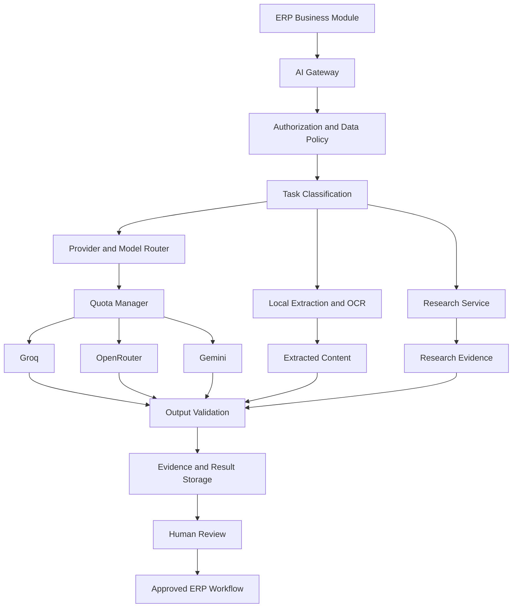
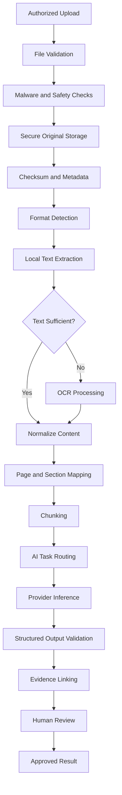

# AI PROVIDER AND DOCUMENT PROCESSING DESIGN

**Project:** Infinity ERP Next  
**Document:** AI Provider and Document Processing Design  
**Version:** 1.0  
**Status:** Proposed design — subject to business-owner and technical approval  
**Date:** 12 November 2026

---

# 1. PURPOSE

This document defines the target architecture for AI services,
external AI providers, document extraction, OCR, research,
AI-assisted business analysis, evidence management, and human review.

The objective is to establish a provider-independent AI platform
that supports tender management, procurement, import operations,
document intelligence, and other approved ERP workflows.

The architecture must allow AI providers to be changed without
rewriting the ERP's business modules.

AI must enhance human decision-making rather than silently
replace business authorization and approval.

# 2. AI DESIGN OBJECTIVES

The AI platform should:

1. Support multiple AI providers.
2. Prefer eligible free or zero-cost services.
3. Accept documented daily usage limits.
4. Avoid assuming unlimited free API access.
5. Provide controlled provider fallback.
6. Support local document extraction.
7. Support OCR for scanned documents.
8. Support structured AI outputs.
9. Preserve source evidence.
10. Distinguish verified facts from AI interpretations.
11. Support human review and correction.
12. Protect company and confidential data.
13. Track usage, quotas, cost, and failures.
14. Support asynchronous processing.
15. Allow new providers and models to be added.
16. Prevent AI failures from blocking unrelated ERP operations.

# 3. AI ARCHITECTURE PRINCIPLES

The platform SHALL follow these principles:

- Provider independence.
- Model independence.
- Business-module independence.
- Secure server-side credentials.
- Company-scoped authorization.
- Quota-aware provider selection.
- Explicit retry and fallback policies.
- Local-first extraction where practical.
- Evidence traceability.
- Human review for consequential results.
- Reproducible processing records.
- Cost and usage transparency.
- No automatic business approval based solely on AI output.

# 4. TARGET AI ARCHITECTURE

The architecture should separate ERP business modules from
provider-specific integrations.

Major components:

1. AI Gateway.
2. Provider Registry.
3. Model Capability Registry.
4. Provider Quota Manager.
5. Task Router.
6. Prompt and Template Registry.
7. Document Extraction Service.
8. OCR Service.
9. Research Service.
10. Structured Output Validator.
11. Evidence and Citation Manager.
12. Human Review Service.
13. AI Usage and Audit Service.
14. Background Processing Workers.

# 5. AI GATEWAY

## 5.1 Purpose

The AI Gateway is the only approved application entry point for
AI inference and AI-related services.

Business modules must not directly embed provider-specific API
calls throughout their code.

Examples of consumers:

- Tender Discovery.
- Tender Management.
- AI War Room.
- Procurement.
- Supplier Management.
- Product Catalog.
- Import and Logistics.
- Landed Cost Analysis.
- Document Management.
- Reporting.

## 5.2 Gateway responsibilities

The gateway should:

- Authenticate internal service requests.
- Verify user and company authorization.
- Classify the AI task.
- Apply data-sharing policies.
- Select a compatible provider and model.
- Check provider availability and quota.
- Submit requests.
- Validate responses.
- Normalize provider errors.
- Record usage.
- Store processing metadata.
- Return structured results.

## 5.3 Provider abstraction

Provider integrations should implement a common interface.

Conceptual operations:

- generate_text
- generate_structured_output
- analyze_document
- generate_embeddings
- classify_content
- extract_information
- summarize_content
- research_web

Not every provider must support every operation.

Capability checks must occur before routing a task.

# 6. INITIAL AI PROVIDER STRATEGY

The initial provider strategy is:

1. Groq — preferred primary inference provider when an eligible
   free model supports the task.
2. OpenRouter — fallback provider when a compatible free model
   is available.
3. Gemini — optional provider for supported document and
   multimodal workflows.
4. Local extraction and OCR — preferred for operations that
   do not require external AI.
5. Tavily — optional live web research service subject to its
   current access and quota limits.

This is a proposed routing priority, not a guarantee that any
provider will always be available or free.

The provider registry must support future alternatives.

# 7. GROQ INTEGRATION

## 7.1 Role

Groq should be considered the preferred primary inference provider
for compatible text and structured-output tasks.

Potential tasks:

- Summarization.
- Classification.
- Requirement extraction from prepared text.
- Draft generation.
- Structured analysis.
- Question answering.
- Risk identification.
- Commercial analysis support.

## 7.2 Integration requirements

The Groq adapter should:

- Use server-side credentials.
- Query or maintain available model capabilities.
- Respect current provider rate limits.
- Respect token and request limits.
- Normalize provider responses.
- Handle quota exhaustion.
- Handle timeouts.
- Handle temporary provider failures.
- Record model and usage metadata.

## 7.3 Model selection

Do not permanently hard-code a model as available or free.

Model eligibility must be configurable and periodically reviewed.

A model must be selected based on:

- Task compatibility.
- Context capacity.
- Structured-output capability.
- Current availability.
- Quota.
- Data policy.
- Quality requirements.

# 8. OPENROUTER INTEGRATION

## 8.1 Role

OpenRouter should provide an alternative inference route where
compatible free models are available.

## 8.2 Requirements

The adapter should:

- Discover or maintain model availability.
- Identify free-tier model eligibility.
- Verify supported capabilities.
- Track model-specific rate limits.
- Track provider-specific quota.
- Normalize response formats.
- Preserve model identifiers.
- Handle provider errors.

## 8.3 Free model safeguards

A model advertised as free must not be assumed to be:

- Permanently available.
- Unlimited.
- Suitable for every task.
- Available at every time.
- Capable of processing every document format.

The system must check eligibility before routing.

# 9. GEMINI INTEGRATION

## 9.1 Role

Gemini may be used as an optional provider for compatible
multimodal and document-related workflows.

The existing ERP contains Gemini-centered AI integration.
The redesign should isolate that integration behind the AI Gateway.

## 9.2 Migration requirements

The new architecture must:

- Preserve useful existing AI capabilities.
- Avoid making Gemini mandatory.
- Move provider-specific logic into an adapter.
- Separate file extraction from inference.
- Support local extraction where practical.
- Support alternative providers for extracted text.
- Preserve source-document references.
- Record provider and model metadata.

## 9.3 Direct document processing

Direct provider file processing may be used when supported and
approved by the data policy.

Local extraction should remain available as an alternative.

Large files should not be sent externally without authorization,
quota checks, and data-sharing evaluation.

# 10. TAVILY LIVE RESEARCH

## 10.1 Purpose

Tavily may provide web research capabilities for approved tasks.

Potential uses:

- Tender opportunity research.
- Manufacturer research.
- Supplier discovery.
- Product research.
- Market information.
- Regulatory and technical source discovery.

## 10.2 Research separation

Research should be separate from ordinary inference.

The research service should:

1. Receive an authorized research request.
2. Apply company and data-sharing policies.
3. Execute a permitted search.
4. Collect source URLs and available metadata.
5. Preserve retrieval timestamps.
6. Return source material for analysis.
7. Distinguish source content from AI interpretation.

## 10.3 Research evidence

Each source should preserve:

- URL.
- Title where available.
- Publisher or domain.
- Retrieval timestamp.
- Relevant excerpt.
- Research query.
- Source identifier.
- Reliability or review status.

The system must not present an AI-generated citation as a
verified source unless the source was actually retrieved.

## 10.4 Quota management

Research requests must respect provider quotas and usage limits.

When the quota is exhausted, the system should:

- Stop unnecessary retries.
- Record the quota event.
- Report that live research is unavailable.
- Offer existing cached or previously retrieved evidence
  where appropriate.
- Permit a later retry when quota is available.

# 11. PROVIDER REGISTRY

Maintain a configurable provider registry.

Suggested fields:

- Provider identifier.
- Provider name.
- Adapter class or service identifier.
- Active status.
- Supported operations.
- Supported modalities.
- Authentication method.
- Configuration reference.
- Priority.
- Health status.
- Last health-check timestamp.
- Documentation reference.

Secrets must not be stored directly in ordinary provider records.

Provider configuration must have an explicit scope: platform-managed
or company-specific. Company-specific settings must remain isolated
to their owning company. Configuration records must be versioned or
otherwise historically traceable without storing secret values
directly in ordinary database records.

The registry must allow a provider to be disabled without
changing business-module code.

# 12. MODEL CAPABILITY REGISTRY

Maintain a separate model registry.

Suggested fields:

- Model identifier.
- Provider identifier.
- Model name.
- Active status.
- Supported tasks.
- Context limit.
- Maximum output limit where known.
- Text capability.
- Image capability.
- Audio capability.
- Structured-output capability.
- Tool-use capability.
- File-processing capability.
- Free-tier eligibility status.
- Eligibility verification date.
- Operational priority.

Capability information must be verified and updated.

Unknown capabilities must not be assumed.

# 13. TASK ROUTING

## 13.1 Task classification

The gateway should classify requests into categories:

- Simple text generation.
- Long-form analysis.
- Structured extraction.
- Classification.
- Document summarization.
- Technical comparison.
- Commercial analysis.
- Image analysis.
- OCR.
- Live research.
- Embedding generation.
- Translation.
- Report drafting.

## 13.2 Routing decisions

Routing should consider:

1. Required capability.
2. Data sensitivity.
3. Company policy.
4. Provider availability.
5. Model compatibility.
6. Remaining quota.
7. Context requirements.
8. Expected quality.
9. Latency.
10. Cost.

## 13.3 Deterministic routing

The same routing policy should produce explainable decisions.

Store the selected provider, model, policy version, and routing
reason for each completed AI request.

# 14. QUOTA AND COST MANAGEMENT

## 14.1 Objectives

The system must prioritize zero-cost usage where possible while
recognizing that free tiers may change.

## 14.2 Quota dimensions

Track available limits where exposed:

- Requests per minute.
- Tokens per minute.
- Requests per day.
- Tokens per day.
- Monthly usage.
- File-processing limits.
- Concurrent request limits.
- Research request limits.

## 14.3 Quota ledger

Maintain usage records containing:

- Provider.
- Model.
- Company.
- User or service.
- AI task.
- Request timestamp.
- Input tokens where reported.
- Output tokens where reported.
- Estimated or reported cost.
- Success or failure.
- Quota information where available.
- Request correlation identifier.

Quota policies must identify their applicable company and provider
scope, with optional model- or task-specific restrictions. Quota
snapshots must identify the provider, applicable model or policy
where relevant, and the observation period. Preserve historical
snapshots rather than overwriting earlier observations.

## 14.4 Quota behavior

When a provider reports quota exhaustion:

1. Mark the relevant provider/model route temporarily unavailable.
2. Record the failure.
3. Avoid immediate repeated requests to the exhausted route.
4. Check compatible fallback providers.
5. Route only when the fallback meets task requirements.
6. Return a clear unavailable result when no route remains.

Do not retry indefinitely.

## 14.5 Free-tier policy

Zero-cost provider use is the initial preference.

The application must not silently move to a paid model or provider.

Any paid route must require explicit configuration and approval.

Where free capacity is unavailable, the application should queue,
defer, or report the task as unavailable according to business policy.

# 15. FAILOVER AND RESILIENCE

## 15.1 Failure categories

Normalize provider errors into categories:

- Authentication failure.
- Invalid request.
- Unsupported capability.
- Quota exhaustion.
- Rate limiting.
- Timeout.
- Temporary service failure.
- Content restriction.
- Invalid response.
- Network failure.

## 15.2 Fallback rules

Fallback should occur only when:

- The original route is unavailable.
- The fallback supports the requested task.
- The fallback meets the data policy.
- The fallback has sufficient quota.
- The fallback is approved for the relevant data class.

## 15.3 Retry policy

Use bounded retries with controlled backoff for transient failures.

Do not retry:

- Invalid credentials without configuration correction.
- Invalid requests.
- Unsupported capabilities.
- Confirmed quota exhaustion before availability changes.

## 15.4 Circuit breaker

A provider/model route should be temporarily suspended after
repeated qualifying failures.

The circuit breaker should:

- Track failure rates.
- Open after a configurable threshold.
- Allow a controlled recovery check.
- Close after successful recovery.
- Record state changes.

# 16. LOCAL DOCUMENT EXTRACTION

## 16.1 Local-first principle

Where possible, extract document content locally before sending
text to an external AI provider.

This reduces:

- External file transfers.
- Provider file-processing dependency.
- Token consumption.
- Processing cost.
- Unnecessary exposure of confidential documents.

## 16.2 Supported document formats

Initial processing targets:

- PDF.
- DOCX.
- XLSX.
- CSV.
- TXT.
- Common image formats.
- Scanned PDF documents.

Other formats may be added through controlled extensions.

## 16.3 Extraction metadata

For each document, preserve:

- Original document identifier.
- File name.
- File type.
- File size.
- Checksum.
- Company.
- Uploader.
- Upload timestamp.
- Extraction engine.
- Extraction version.
- Processing timestamp.
- Extraction status.
- Page, sheet, or section references.

## 16.4 PDF extraction

PDF processing should support:

- Text extraction.
- Page-level references.
- Table extraction where possible.
- Page ordering.
- Layout-aware extraction where needed.
- Detection of scanned pages.
- Extraction quality indicators.

The original PDF must remain unchanged.

## 16.5 DOCX extraction

DOCX processing should preserve:

- Headings.
- Paragraphs.
- Tables.
- Lists.
- Section order.
- Relevant document metadata.

## 16.6 XLSX extraction

XLSX processing should preserve:

- Sheet names.
- Cell values.
- Formulas where relevant.
- Table structures.
- Row and column references.
- Merged cell information where relevant.

Formula values must not be assumed accurate if the workbook
has not been recalculated by a compatible spreadsheet engine.

## 16.7 CSV and TXT extraction

Preserve:

- Encoding information.
- Delimiters.
- Header rows.
- Record ordering.
- Source file references.

# 17. OCR AND SCANNED DOCUMENTS

## 17.1 OCR requirements

OCR should support scanned tender documents, certificates,
invoices, quotations, and other authorized business records.

## 17.2 OCR processing

The pipeline should:

1. Detect image-based or text-deficient pages.
2. Render pages safely.
3. Run an approved OCR engine.
4. Preserve page references.
5. Store extracted text.
6. Record OCR confidence where available.
7. Flag uncertain results for review.
8. Preserve the original source.

## 17.3 Language support

The architecture should allow multiple OCR languages.

Initial language requirements should be confirmed with business users.

Potential requirements include English and other languages used
in supplier, tender, and trade documents.

## 17.4 OCR review

Low-confidence or ambiguous extraction must be flagged.

Users should be able to compare extracted text with the source page.

OCR output must not automatically become verified financial or
contractual information.

# 18. DOCUMENT PROCESSING PIPELINE

# 19. DOCUMENT CHUNKING

Large documents may exceed model context limits.

Chunking should preserve:

- Original document identity.
- Page numbers.
- Section headings.
- Table boundaries.
- Paragraph boundaries.
- Sequence information.
- Relevant metadata.

Avoid splitting critical tables or clauses without preserving
their relationships.

Each chunk should have a stable identifier.

AI results must be traceable to the exact source chunks used.

# 20. STRUCTURED OUTPUT AND VALIDATION

AI output should use defined schemas where practical.

Examples:

- Tender requirement.
- Compliance finding.
- Supplier profile.
- Product specification.
- Price comparison.
- Commercial risk.
- Document classification.
- Shipment milestone extraction.

Validation should include:

- Required fields.
- Data types.
- Allowed values.
- Numeric precision.
- Date formats.
- Reference integrity.
- Company ownership.
- Evidence references.

Invalid responses should be rejected or sent for controlled
correction.

Never silently convert invalid AI output into approved business data.

# 21. EVIDENCE AND SOURCE TRACEABILITY

## 21.1 Evidence requirement

Every material AI-generated finding should identify its supporting
source evidence or clearly state that evidence is unavailable.

## 21.2 Evidence references

Evidence may include:

- Document identifier.
- Page number.
- Sheet name.
- Cell reference.
- Section heading.
- Paragraph or chunk identifier.
- External source URL.
- Retrieved timestamp.
- Quoted or extracted passage.

## 21.3 Evidence classification

Use explicit categories:

- Direct source evidence.
- Extracted information.
- AI interpretation.
- User-provided information.
- External research.
- Assumption.
- Missing evidence.
- Unverified claim.

## 21.4 Citation integrity

AI-generated page numbers, URLs, and references must be validated
against actual source records.

A citation that cannot be verified must be marked unverified.

# 22. HUMAN REVIEW AND APPROVAL

AI results must enter a review process when they affect important
business decisions.

Review actions may include:

- Accept.
- Reject.
- Correct.
- Request regeneration.
- Mark uncertain.
- Escalate.
- Approve for workflow use.

Review metadata should contain:

- Reviewer.
- Company.
- Review timestamp.
- Original AI output.
- Corrected output.
- Decision.
- Comments.
- Source evidence.
- Processing version.

Persist review actions separately from approval decisions. Each
review and approval must identify the acting company membership,
decision, timestamp and relevant comments or evidence references.
Approval for workflow use is an AI-result governance decision only;
it does not replace the ERP's normal workflow approval authority.

An AI artifact produced from a run or review must retain its
originating run and, where applicable, its review or approval
references. Artifact versions must remain traceable to that source.

AI must not independently:

- Submit a tender.
- Approve a purchase order.
- Post a journal.
- Release a payment.
- Approve payroll.
- Adjust inventory.
- Sign a contract.
- Make a binding supplier commitment.

Such actions remain subject to normal ERP permissions and approvals.

# 23. AI WAR ROOM INTEGRATION

The AI War Room should use the gateway for all AI inference.

It should support:

- Tender document intake.
- Requirement extraction.
- Technical compliance analysis.
- Commercial analysis.
- Pricing support.
- Risk identification.
- Supplier and manufacturer research.
- Clarification analysis.
- Document checklist generation.
- Executive summaries.
- Exportable work products.

Existing War Room capabilities must be inventoried and mapped
before migration.

The redesigned AI services must preserve useful existing
artifacts and workflows until replacement acceptance.

# 24. AI PROMPT AND TEMPLATE MANAGEMENT

Prompts should be centrally managed and versioned.

A prompt record should include:

- Prompt identifier.
- Name.
- Module.
- Task type.
- Version.
- Template content.
- Expected output schema.
- Applicable model capabilities.
- Approval status.
- Created-by reference.
- Effective date.

Production prompt changes should be reviewable and traceable.

Sensitive information must not be embedded in reusable prompt templates.

Prompt instructions must not override authorization, company
isolation, or business approval rules.

# 25. AI DATA SECURITY

## 25.1 Authorization

Before processing, verify:

- User authentication.
- Active company membership.
- Source-document access.
- AI task permission.
- Data-sharing policy.
- Applicable retention rules.

## 25.2 External transmission

Do not send confidential or personal information externally
unless the applicable policy permits it.

Where appropriate, minimize or redact sensitive fields.

## 25.3 Credentials

Provider credentials must:

- Be stored server-side.
- Be supplied through environment configuration or secret management.
- Never be committed to Git.
- Never be returned to browser clients.
- Be rotatable.
- Be restricted to required services.

## 25.4 Data retention

Define retention for:

- Original documents.
- Extracted text.
- OCR output.
- AI prompts.
- AI responses.
- Provider metadata.
- Research results.
- Review records.

Retention must follow approved company and legal policies.

# 26. AI PROMPT INJECTION AND UNTRUSTED CONTENT

Documents, external web pages, and extracted text must be treated
as untrusted input.

The system must not follow instructions found inside source
documents merely because an AI model encounters them.

Controls should include:

- Clear separation of system instructions and source content.
- Explicit treatment of documents as data.
- Restricted tool access.
- No unrestricted execution of extracted instructions.
- Validation of AI-generated actions.
- Human review of consequential outputs.
- Source and result traceability.

An external document must never grant itself additional ERP permissions.

# 27. ASYNCHRONOUS PROCESSING

Long-running extraction and AI operations should execute through
background workers.

Suggested states:

- Queued.
- Validating.
- Extracting.
- OCR Processing.
- Waiting for Provider.
- Analyzing.
- Validating Output.
- Awaiting Review.
- Completed.
- Failed.
- Cancelled.

Jobs should support:

- Progress reporting.
- Controlled retries.
- Idempotency.
- Cancellation where safe.
- Failure diagnostics.
- Correlation identifiers.
- Company context.
- Audit records.

A failed AI job must not corrupt its source business record.

# 28. AI CACHE AND REUSE

Caching may reduce repeated processing.

Cache keys should account for:

- Source document checksum.
- Extraction version.
- Prompt version.
- Model.
- Provider.
- Relevant processing parameters.
- Company and data policy.

Cached results must not bypass authorization.

A result produced for one company must not become visible to
another company merely because the source content is similar.

Users must be able to identify when a result was reused from
previous processing.

# 29. AI USAGE MONITORING

The AI administration workspace should show authorized metrics:

- Requests by provider.
- Requests by model.
- Success rate.
- Failure rate.
- Quota exhaustion.
- Token usage where available.
- Estimated cost.
- Average latency.
- Processing queue.
- OCR volume.
- Research usage.
- Provider availability.

Usage dashboards must distinguish reported values from estimates.

Only authorized users may access provider configuration and
sensitive usage information.

# 30. AI ERROR HANDLING

Errors should be normalized and understandable.

Examples:

- Provider unavailable.
- Quota exhausted.
- Unsupported file type.
- Extraction failed.
- OCR required.
- OCR confidence insufficient.
- Invalid structured response.
- Source evidence missing.
- Data-sharing policy blocked request.
- Authorization denied.
- Processing timeout.

The user should receive a useful explanation without exposure
of provider credentials or internal secrets.

# 31. AI DATABASE DESIGN INPUTS

The following canonical entities are defined in the database
design and must be used during detailed implementation:

1. AIProvider
2. AIProviderCapability
3. AIModel
4. AIProviderConfiguration
5. AIUsagePolicy
6. AITask
7. AIJob
8. AIRun
9. AIPromptTemplate
10. AIPromptVersion
11. AIResponse
12. AIOutputValidation
13. AIEvidence
14. AIResearchSource
15. AIExtractionResult
16. AIReview
17. AIApproval
18. AIArtifact
19. AIArtifactVersion
20. AIUsageRecord
21. AIQuotaSnapshot
22. AIErrorLog
23. DocumentExtraction
24. DocumentPageExtraction
25. DocumentChunk
26. OCRJob
27. ResearchRequest
28. ProviderHealthEvent

Canonical naming rules:

- AIProcessingRun is represented by AIRun.
- AIProcessingResult is represented by AIResponse.
- AIEvidenceReference is represented by AIEvidence.
- ResearchSource is represented by AIResearchSource.
- AIExtractionResult is distinct from DocumentExtraction:
  the former stores structured AI-produced results, while the
  latter stores content extracted from the original document.

Do not introduce alternate entity names for these same concepts.
Any future entity addition or rename must be reflected in both
this document and the database design.

# 32. AI ACCEPTANCE CRITERIA

The AI platform is acceptable when:

- Business modules use the AI Gateway.
- Provider-specific logic is isolated.
- Groq can be configured as a primary provider.
- OpenRouter can be configured as a fallback.
- Gemini can be enabled or disabled independently.
- Tavily research is separated from inference.
- Local extraction works without external AI.
- OCR can process supported scanned documents.
- Provider quotas are tracked where available.
- Quota exhaustion does not cause unlimited retries.
- Paid routes are not silently activated.
- Provider failures are normalized.
- Structured outputs are validated.
- Results preserve source evidence.
- Unverified findings are clearly labeled.
- Human review is available.
- Company authorization is enforced.
- AI credentials remain server-side.
- Prompt and model versions are traceable.
- Processing jobs are auditable.
- Existing useful War Room capabilities are mapped before migration.
- AI cannot bypass ERP approvals.

# 33. OPEN AI DESIGN DECISIONS

The following require technical and business approval:

1. Final provider list.
2. Initial Groq model selection.
3. OpenRouter fallback model selection.
4. Gemini usage scope.
5. Tavily access and research quota.
6. OCR engine.
7. PDF extraction library.
8. Document table extraction approach.
9. Embedding and vector search strategy.
10. AI result retention.
11. Prompt approval governance.
12. External data-sharing policy.
13. AI review roles.
14. Background processing technology.
15. Provider health-check frequency.

Provider model names, free-tier limits, and capabilities must be
verified at implementation time rather than assumed from this document.

# 34. IMPLEMENTATION PHASING

## Phase 1 — Foundation

- AI Gateway.
- Provider abstraction.
- Groq adapter.
- OpenRouter adapter.
- Basic quota tracking.
- Local PDF and DOCX extraction.
- Structured output validation.
- Basic audit metadata.

## Phase 2 — Document Intelligence

- OCR integration.
- XLSX extraction.
- Document chunking.
- Evidence references.
- Human review interface.
- Asynchronous processing.

## Phase 3 — Research and Advanced Analysis

- Tavily integration.
- Research source management.
- Gemini optional adapter.
- Advanced tender analysis.
- Supplier and product research.
- Commercial analysis support.

## Phase 4 — Optimization

- Advanced provider routing.
- Model evaluation.
- Cache optimization.
- Usage analytics.
- Quality monitoring.
- Advanced document search.

Phases are proposed and subject to implementation prioritization.

# 35. DOCUMENT STATUS AND GOVERNANCE

**Status:** Proposed AI provider and document processing design.

This document defines the target design and does not claim that
any provider integration, OCR service, or AI workflow has already
been implemented.

Business-owner and technical approval are required before
implementation.

---

# 36. NEXT DOCUMENT

The next planned document is:

`docs/07-migration/DATA_MIGRATION_STRATEGY.md`

It will define the controlled migration from the existing ERP,
including data inventory, mapping, cleansing, reconciliation,
security preservation, migration rehearsals, rollback, and cutover.
