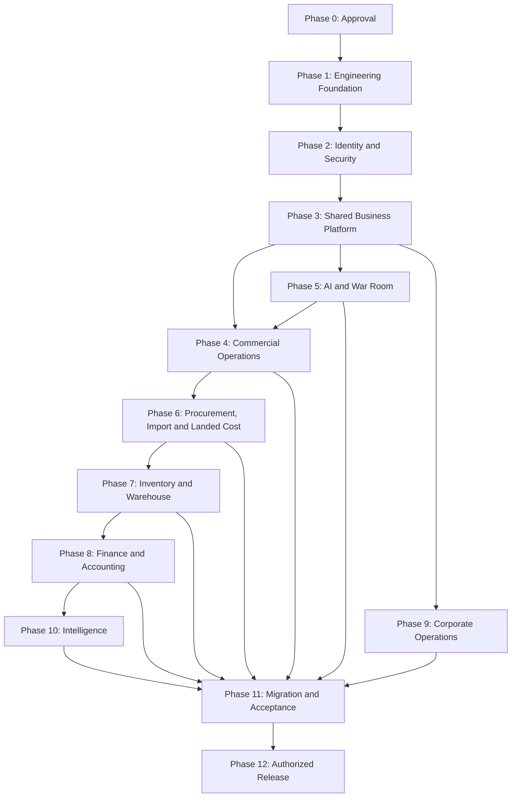

# IMPLEMENTATION BACKLOG

**Project:** Infinity ERP Next  
**Document:** Implementation Backlog  
**Version:** 1.0  
**Status:** Proposed implementation roadmap — subject to approval  
**Date:** 12 November 2026

---

# 1. PURPOSE

This document translates the discovery, requirements, architecture,
database, security, UI, AI, and migration designs into an organized
implementation backlog.

It defines:

- Implementation phases.
- Epics.
- Work packages.
- Priorities.
- Dependencies.
- Deliverables.
- Acceptance criteria.
- Release gates.
- Implementation governance.

The backlog is intended to guide the development of Infinity ERP Next
from an approved design into a production-ready enterprise platform.

This document does not authorize implementation, production changes,
migration, deployment, or cutover.

# 2. BACKLOG GOVERNANCE

## 2.1 Backlog principles

Implementation must follow these principles:

1. Build the foundation before dependent business modules.
2. Implement company isolation before business data.
3. Implement authorization before exposing module operations.
4. Use approved database designs.
5. Keep business logic within defined domain boundaries.
6. Preserve financial integrity.
7. Prefer reusable shared services.
8. Implement auditability from the beginning.
9. Build automated verification into implementation work.
10. Avoid premature microservices.
11. Avoid duplicated business logic.
12. Deliver in small, reviewable increments.
13. Protect the existing production ERP.
14. Require explicit approval before production cutover.

## 2.2 Priority definitions

| Priority | Meaning |
|---|---|
| P0 | Essential foundation or release blocker |
| P1 | High-priority business capability |
| P2 | Important enhancement |
| P3 | Later optimization or optional capability |

## 2.3 Work item status

Use these statuses:

- Proposed.
- Awaiting Approval.
- Ready.
- In Progress.
- Blocked.
- In Review.
- Accepted.
- Deferred.
- Cancelled.

A proposed work item must not be treated as approved.

## 2.4 Work package structure

Each work package should identify:

- Work package ID.
- Epic.
- Description.
- Priority.
- Dependencies.
- Deliverables.
- Acceptance criteria.
- Responsible role.
- Status.

# 3. IMPLEMENTATION STRATEGY

The target implementation approach is a modular monolith.

The initial backend should use the approved Django architecture,
with API capabilities for the frontend.

The frontend should use the approved React and TypeScript direction.

The target database is PostgreSQL.

Background processing, caching, object storage, and AI services
must follow the approved architecture decisions.

Technology versions and deployment choices must be confirmed
before implementation.

# 4. IMPLEMENTATION PHASES

| Phase | Name | Primary objective |
|---|---|---|
| 0 | Discovery and approval | Approve scope and designs |
| 1 | Engineering foundation | Establish the application foundation |
| 2 | Identity and security | Implement secure company access |
| 3 | Shared business platform | Establish common ERP services |
| 4 | Core commercial operations | Implement tenders, bids and suppliers |
| 5 | AI and War Room | Deliver controlled AI-assisted operations |
| 6 | Procurement and import | Implement purchasing and international trade |
| 7 | Inventory and landed cost | Implement stock and cost management |
| 8 | Finance and accounting | Implement double-entry finance |
| 9 | Corporate operations | Implement HR, legal, IT and administration |
| 10 | Intelligence and optimization | Deliver advanced analytics |
| 11 | Migration and acceptance | Validate migration and readiness |
| 12 | Controlled release | Execute authorized production cutover |

Phases may overlap only where dependencies and controls permit.

# 5. PHASE 0 — DISCOVERY AND APPROVAL

**Priority:** P0

Objective: Establish an approved and traceable implementation baseline.

## EPIC E00 — Requirements and design governance

### WP-E00-001 — Approve master blueprint

- Review the master blueprint.
- Confirm company scope.
- Confirm module scope.
- Confirm business priorities.
- Record approved changes.

**Acceptance criteria:**
- Business owner approval recorded.
- Scope and exclusions documented.
- Version approved.

### WP-E00-002 — Approve existing ERP inventory

- Review existing functional inventory.
- Validate source-code findings.
- Identify missing discovery areas.
- Record unresolved assumptions.

**Acceptance criteria:**
- Functional inventory reviewed.
- Source limitations documented.
- Migration discovery requirements identified.

### WP-E00-003 — Approve business requirements

- Review functional requirements.
- Review non-functional requirements.
- Prioritize business gaps.
- Assign requirement owners.

**Acceptance criteria:**
- Requirements approved.
- Priority and status assigned.
- Traceability established.

### WP-E00-004 — Approve target architecture

- Review modular monolith architecture.
- Confirm technology choices.
- Confirm integration strategy.
- Confirm deployment strategy.

**Acceptance criteria:**
- Architecture decisions approved.
- Open decisions assigned.
- Architecture baseline established.

### WP-E00-005 — Approve database design

- Review entity relationships.
- Validate company ownership.
- Review financial data model.
- Review constraints and indexes.

**Acceptance criteria:**
- Logical data model approved.
- Critical relationships reviewed.
- Migration compatibility considered.

### WP-E00-006 — Approve security design

- Review identity architecture.
- Review company isolation.
- Review company-scoped roles.
- Review audit requirements.
- Review privileged-account policy.

**Acceptance criteria:**
- Security design approved.
- Company authorization requirements documented.
- No unrestricted SUPERADMIN model introduced.

### WP-E00-007 — Approve UI blueprint

- Review navigation.
- Review module workspaces.
- Review desktop and mobile behavior.
- Confirm design system direction.

**Acceptance criteria:**
- UI blueprint approved.
- Primary user journeys identified.
- Navigation structure accepted.

### WP-E00-008 — Approve AI design

- Confirm provider strategy.
- Confirm free-tier operating policy.
- Confirm external data-sharing rules.
- Confirm document processing requirements.

**Acceptance criteria:**
- AI governance approved.
- Provider policies documented.
- Human-review boundaries accepted.

### WP-E00-009 — Approve migration strategy

- Review source data scope.
- Review reconciliation controls.
- Review migration environment.
- Review rollback strategy.

**Acceptance criteria:**
- Migration approach approved.
- Production restrictions documented.
- Reconciliation owners assigned.

# 6. PHASE 1 — ENGINEERING FOUNDATION

**Priority:** P0

Objective: Establish the application structure, development standards,
deployment foundation, and reusable engineering services.

## EPIC E01 — Repository and engineering standards

### WP-E01-001 — Establish repository structure

Deliverables:

- Backend application structure.
- Frontend application structure.
- Shared configuration.
- Documentation organization.
- Development tooling.

Acceptance criteria:

- Repository structure approved.
- Domain boundaries documented.
- Configuration separated from application code.

### WP-E01-002 — Establish development conventions

Deliverables:

- Coding standards.
- Naming conventions.
- Error-handling standards.
- API conventions.
- Logging conventions.
- Branch and review process.

Acceptance criteria:

- Standards documented.
- Review requirements defined.
- Sensitive information excluded from source control.

### WP-E01-003 — Establish environment configuration

Deliverables:

- Development configuration.
- Test configuration.
- Staging configuration.
- Production configuration.
- Environment-variable documentation.

Acceptance criteria:

- Secrets are external to source code.
- Environment separation is enforced.
- Missing required configuration fails safely.

## EPIC E02 — Backend foundation

### WP-E02-001 — Establish Django application foundation

- Configure Django.
- Establish application settings.
- Configure database connectivity.
- Establish modular application structure.

Acceptance criteria:

- Application starts in development.
- Configuration is environment-specific.
- Domain applications are independently organized.

### WP-E02-002 — Establish API foundation

- Configure Django REST Framework.
- Define API versioning.
- Define response conventions.
- Define error response format.
- Configure API authentication integration.

Acceptance criteria:

- API structure is documented.
- Errors are consistent.
- Authorization is not bypassed.

### WP-E02-003 — Establish PostgreSQL foundation

- Configure PostgreSQL.
- Define migration conventions.
- Establish database naming standards.
- Define backup and recovery approach.

Acceptance criteria:

- Database configuration is secure.
- Schema changes are version-controlled.
- Backup and recovery requirements are documented.

## EPIC E03 — Frontend foundation

### WP-E03-001 — Establish React and TypeScript application

Deliverables:

- Application shell.
- Routing foundation.
- Shared component structure.
- API client.
- Error boundaries.

Acceptance criteria:

- Frontend builds successfully.
- Routing is structured.
- API configuration is environment-specific.

### WP-E03-002 — Establish design system

Deliverables:

- Typography.
- Color tokens.
- Spacing.
- Buttons.
- Forms.
- Tables.
- Dialogs.
- Status indicators.

Acceptance criteria:

- Shared components are reusable.
- Accessibility requirements are documented.
- Responsive behavior is supported.

### WP-E03-003 — Establish responsive layouts

- Desktop shell.
- Tablet layout.
- Mobile layout.
- Navigation behavior.
- Accessible interaction patterns.

Acceptance criteria:

- Primary layouts work across supported screen sizes.
- Critical workflows remain usable on mobile.

## EPIC E04 — Platform operations

### WP-E04-001 — Establish application logging

- Structured logs.
- Request correlation.
- Error classification.
- Sensitive-data redaction.

Acceptance criteria:

- Errors are traceable.
- Secrets and sensitive data are not logged.

### WP-E04-002 — Establish health monitoring

- Application health.
- Database health.
- Background worker health.
- Storage health.

Acceptance criteria:

- Operational health is observable.
- Failures can be diagnosed.

### WP-E04-003 — Establish backup and recovery controls

- Backup policy.
- Restore procedure.
- Recovery objectives.
- Backup verification.

Acceptance criteria:

- Recovery process is documented.
- Restore verification is defined.

# 7. PHASE 2 — IDENTITY AND SECURITY

**Priority:** P0

Objective: Implement identity, membership-based authorization,
company isolation, and audit controls before business modules.

## EPIC E05 — Identity management

### WP-E05-001 — Implement user identity

- User account model.
- Authentication.
- Account activation.
- Account suspension.
- Password reset.

Acceptance criteria:

- Authentication works securely.
- Suspended users cannot authenticate.
- Account lifecycle is auditable.

### WP-E05-002 — Implement employee identity relationship

- Employee records.
- User-to-employee relationships.
- Employment status.
- Historical identity references.

Acceptance criteria:

- User and employee identities remain distinct.
- Relationships are validated.

## EPIC E06 — Company membership

### WP-E06-001 — Implement company registry

- Company records.
- Company status.
- Company configuration.

Acceptance criteria:

- YAH and CHI can be represented.
- Future companies can be added without redesigning authorization.

### WP-E06-002 — Implement company memberships

- User membership.
- Membership status.
- Membership dates.
- Company context.

Acceptance criteria:

- Users access only companies where membership permits access.
- Membership changes are audited.

### WP-E06-003 — Implement company-scoped roles

- Company role definitions.
- Role assignments.
- Permission mapping.
- Role lifecycle.

Acceptance criteria:

- ADMIN permissions are company-scoped.
- No unrestricted SUPERADMIN role is introduced.
- Role changes are auditable.

## EPIC E07 — Authorization and isolation

### WP-E07-001 — Implement permission framework

- Module permissions.
- Action permissions.
- Object-level permissions.
- Approval permissions.

Acceptance criteria:

- Every protected operation checks authorization.
- Permission checks are server-side.

### WP-E07-002 — Implement company context

- Active company selection.
- Context validation.
- Context switching.
- Company-aware API requests.

Acceptance criteria:

- Company context cannot be forged to access another company.
- Unauthorized cross-company requests are denied.

### WP-E07-003 — Implement company data isolation

- Company-scoped query services.
- Company ownership validation.
- Background-job company context.
- File access isolation.

Acceptance criteria:

- Cross-company access is prevented.
- Automated authorization verification is included.

### WP-E07-004 — Implement segregation of duties

- Approval policies.
- Maker-checker controls.
- Restricted actions.
- Conflict-of-interest checks.

Acceptance criteria:

- Required approval separation is enforced.
- Approval actions are traceable.

## EPIC E08 — Audit and security operations

### WP-E08-001 — Implement audit trail

- Actor.
- Company.
- Action.
- Entity.
- Timestamp.
- Before and after values where appropriate.
- Request correlation.

Acceptance criteria:

- Critical business operations are auditable.
- Audit records are protected from ordinary alteration.

### WP-E08-002 — Implement security event logging

- Authentication events.
- Permission denials.
- Privileged changes.
- Suspicious access patterns.

Acceptance criteria:

- Security events are recorded.
- Sensitive values are excluded.

### WP-E08-003 — Implement session and API security

- Session controls.
- Token management.
- CSRF protection where applicable.
- Rate limiting.
- API access restrictions.

Acceptance criteria:

- Security controls are reviewed.
- Credentials and tokens are protected.

# 8. PHASE 3 — SHARED BUSINESS PLATFORM

**Priority:** P0

Objective: Deliver common services used by all ERP modules.

## EPIC E09 — Reference data

### WP-E09-001 — Implement common reference data

- Countries.
- Currencies.
- Units of measure.
- Payment terms.
- Tax categories.
- Document types.
- Status definitions.

Acceptance criteria:

- Reference data is centrally managed.
- Company-specific overrides are controlled.

### WP-E09-002 — Implement numbering sequences

- Tender numbers.
- Purchase order numbers.
- Invoice numbers.
- Journal numbers.
- Shipment references.
- Other approved document numbers.

Acceptance criteria:

- Numbering is unique within its approved scope.
- Concurrent requests do not create duplicate numbers.

## EPIC E10 — Document management foundation

### WP-E10-001 — Implement document registry

- Document metadata.
- Company ownership.
- Document categories.
- Version references.

### WP-E10-002 — Implement secure file storage

- Original file storage.
- Access control.
- Download authorization.
- Checksums.
- Retention metadata.

### WP-E10-003 — Implement document versioning

- Version history.
- Original preservation.
- Replacement tracking.
- Document audit.

Acceptance criteria for E10:

- Files are company-isolated.
- File integrity can be verified.
- Unauthorized downloads are denied.
- Version history is traceable.

## EPIC E11 — Workflow and approval foundation

### WP-E11-001 — Implement workflow definitions

- Workflow types.
- Status transitions.
- Transition rules.
- Workflow versions.

### WP-E11-002 — Implement approval engine

- Approval steps.
- Approver assignment.
- Delegation rules.
- Approval history.

### WP-E11-003 — Implement workflow notifications

- In-app notifications.
- Email integration where approved.
- Reminder policies.

Acceptance criteria:

- Invalid transitions are rejected.
- Approval authority is verified.
- Workflow history is auditable.

## EPIC E12 — Task and collaboration foundation

### WP-E12-001 — Implement task management

- Task creation.
- Assignment.
- Due dates.
- Status.
- Priority.
- Company context.

### WP-E12-002 — Implement task history and comments

- Comments.
- Status history.
- Assignment history.
- Activity timeline.

### WP-E12-003 — Implement collaboration services

- Notifications.
- Memos.
- Discussion references.
- Collaboration permissions.

Acceptance criteria:

- Tasks respect company isolation.
- Assignment history is preserved.
- Notifications do not expose unauthorized records.

# 9. PHASE 4 — CORE COMMERCIAL OPERATIONS

**Priority:** P1

Objective: Deliver the core tender, bid, supplier, and product
capabilities needed for commercial operations.

## EPIC E13 — Tender discovery

### WP-E13-001 — Implement tender opportunity registry

- Tender source.
- Reference number.
- Issuing organization.
- Publication date.
- Closing date.
- Tender status.
- Company ownership.

### WP-E13-002 — Implement tender search and filtering

- Keyword search.
- Date filters.
- Category filters.
- Status filters.
- Saved views.

### WP-E13-003 — Implement opportunity evaluation

- Eligibility.
- Strategic fit.
- Estimated value.
- Submission requirements.
- Opportunity risk.

Acceptance criteria:

- Tender opportunities are traceable.
- Search and filtering work correctly.
- Evaluation records preserve reviewer decisions.

## EPIC E14 — Tender and bid management

### WP-E14-001 — Implement tender lifecycle

- Tender creation.
- Tender qualification.
- Tender assignment.
- Tender status.
- Tender closure.

### WP-E14-002 — Implement tender lots and items

- Lot management.
- Item management.
- Specifications.
- Quantity.
- Units.

### WP-E14-003 — Implement bid document management

- Document checklist.
- Document versions.
- Submission package.
- Submission status.
- Deadline tracking.

### WP-E14-004 — Implement tender reviews

- Technical review.
- Commercial review.
- Compliance review.
- Management review.

### WP-E14-005 — Implement award and outcome management

- Award records.
- Unsuccessful outcomes.
- Award value.
- Contract references.

Acceptance criteria:

- Tender lifecycle is auditable.
- Bid documents are versioned.
- Approval and submission authority is enforced.
- Historical T02–T24 workflow requirements are mapped.

## EPIC E15 — Supplier and manufacturer management

### WP-E15-001 — Implement supplier registry

- Supplier identity.
- Contacts.
- Addresses.
- Country.
- Classification.
- Status.

### WP-E15-002 — Implement supplier qualification

- Registration documents.
- Certifications.
- Compliance checks.
- Qualification status.

### WP-E15-003 — Implement supplier performance

- Delivery performance.
- Quality history.
- Commercial performance.
- Review records.

Acceptance criteria:

- Supplier records are traceable.
- Shared supplier access follows approved policy.
- Qualification decisions are auditable.

## EPIC E16 — Product and technical catalog

### WP-E16-001 — Implement product catalog

- Product identity.
- Categories.
- Specifications.
- Units.
- Product status.

### WP-E16-002 — Implement technical specifications

- Attributes.
- Technical documents.
- Standards.
- Compatibility information.

### WP-E16-003 — Implement supplier-product relationships

- Supplier references.
- Manufacturer references.
- Quotation history.
- Product alternatives.

Acceptance criteria:

- Product records support tender and procurement operations.
- Technical specifications are versioned where required.

# 10. PHASE 5 — AI AND WAR ROOM

**Priority:** P1

Objective: Deliver provider-independent AI and controlled document
intelligence.

## EPIC E17 — AI Gateway

### WP-E17-001 — Implement AI gateway foundation

- Unified request interface.
- Task classification.
- Response normalization.
- Correlation identifiers.

### WP-E17-002 — Implement provider registry

- Provider configuration.
- Capability registry.
- Enable/disable controls.
- Health status.

### WP-E17-003 — Implement Groq adapter

- Text inference.
- Structured output.
- Error normalization.
- Usage tracking.

### WP-E17-004 — Implement OpenRouter adapter

- Model selection.
- Free-tier eligibility configuration.
- Fallback handling.
- Usage tracking.

### WP-E17-005 — Implement optional Gemini adapter

- Existing capability migration.
- Provider abstraction.
- Document-processing integration.

Acceptance criteria:

- Business modules do not depend directly on provider-specific APIs.
- Providers can be enabled or disabled independently.
- Credentials remain server-side.

## EPIC E18 — AI quota and resilience

### WP-E18-001 — Implement quota management

- Provider quotas.
- Model quotas.
- Usage records.
- Quota exhaustion handling.

### WP-E18-002 — Implement fallback routing

- Capability checks.
- Data policy checks.
- Compatible fallback.
- Bounded retries.

### WP-E18-003 — Implement AI usage reporting

- Provider usage.
- Model usage.
- Failure rates.
- Cost estimates.
- Quota status.

Acceptance criteria:

- Exhausted providers are not retried indefinitely.
- Paid services are not silently activated.
- Fallback decisions are auditable.

## EPIC E19 — Document intelligence

### WP-E19-001 — Implement PDF extraction

- Text extraction.
- Page references.
- Extraction metadata.

### WP-E19-002 — Implement Office document extraction

- DOCX extraction.
- XLSX extraction.
- CSV extraction.

### WP-E19-003 — Implement OCR

- Scanned document detection.
- OCR processing.
- Confidence indicators.
- Human verification.

### WP-E19-004 — Implement chunking and evidence mapping

- Stable chunk identifiers.
- Page references.
- Section references.
- Evidence linkage.

Acceptance criteria:

- Original documents remain preserved.
- Extracted content is traceable.
- OCR uncertainty is visible.
- Evidence references can be verified.

## EPIC E20 — AI research

### WP-E20-001 — Implement research service

- Research request.
- Source collection.
- URL preservation.
- Retrieval timestamps.

### WP-E20-002 — Implement Tavily adapter

- Live research integration.
- Quota tracking.
- Error handling.

### WP-E20-003 — Implement research evidence management

- Source records.
- Evidence excerpts.
- Reliability review.
- Citation validation.

Acceptance criteria:

- Research is distinct from inference.
- Sources are preserved.
- Unsupported citations are not presented as verified.

## EPIC E21 — AI War Room

### WP-E21-001 — Implement tender document analysis

- Requirement extraction.
- Document classification.
- Compliance support.

### WP-E21-002 — Implement technical analysis

- Specification comparison.
- Compliance findings.
- Evidence references.

### WP-E21-003 — Implement commercial analysis

- Price comparison.
- Cost analysis.
- Commercial risk.
- Assumption identification.

### WP-E21-004 — Implement War Room artifacts

- Structured reports.
- DOCX output.
- XLSX output.
- PDF output.
- CSV output where appropriate.

### WP-E21-005 — Implement human review

- Accept.
- Reject.
- Correct.
- Escalate.
- Approve for workflow use.

Acceptance criteria:

- AI findings are evidence-linked.
- Unverified assumptions are labeled.
- Human review is recorded.
- AI cannot independently approve consequential business transactions.
- Existing useful War Room artifacts are preserved or mapped.

# 11. PHASE 6 — PROCUREMENT AND IMPORT

**Priority:** P1

Objective: Implement controlled purchasing and international trade.

## EPIC E22 — Procurement

### WP-E22-001 — Implement purchase requisitions

- Requisition creation.
- Item lines.
- Business justification.
- Approval.

### WP-E22-002 — Implement supplier quotations

- Quotation requests.
- Quotation receipt.
- Comparison.
- Evaluation.

### WP-E22-003 — Implement purchase orders

- Purchase order creation.
- Purchase order lines.
- Approval.
- Supplier issuance.
- Amendments.

### WP-E22-004 — Implement goods receipts

- Receipt records.
- Quantity verification.
- Quality checks.
- Discrepancies.

Acceptance criteria:

- Procurement follows approval controls.
- Purchase orders are traceable.
- Receipts can be reconciled to purchase orders.

## EPIC E23 — Import and international trade

### WP-E23-001 — Implement import case management

- Import case.
- Origin and destination.
- Shipment references.
- Responsible users.

### WP-E23-002 — Implement import documents

- Commercial invoice.
- Packing list.
- Bill of lading or airway bill.
- Certificate of origin.
- Insurance.
- Customs documents.
- Other required records.

### WP-E23-003 — Implement shipment tracking

- Shipment milestones.
- Carrier information.
- Expected arrival.
- Actual arrival.
- Delivery status.

### WP-E23-004 — Implement customs and clearance tracking

- Customs declarations.
- Duties and taxes.
- Clearance milestones.
- Supporting evidence.

Acceptance criteria:

- Multiple shipments can be associated with the appropriate business records.
- Documents and milestones are traceable.
- Historical I01–I16 requirements are mapped.

## EPIC E24 — Landed cost engine

**Priority:** P0 — Release-critical financial control.

### WP-E24-001 — Implement cost component model

- Purchase value.
- Freight.
- Insurance.
- Customs duty.
- Taxes.
- Port charges.
- Handling.
- Inland transport.
- Other approved expenses.

### WP-E24-002 — Implement allocation methods

- Quantity allocation.
- Value allocation.
- Weight allocation.
- Volume allocation.
- Manual approved allocation.

### WP-E24-003 — Implement landed cost calculation

- Currency conversion.
- Cost allocation.
- Unit landed cost.
- Cost versioning.
- Supporting evidence.

### WP-E24-004 — Implement cost reconciliation

- Verified amounts.
- User-entered amounts.
- Pending amounts.
- Excluded amounts.
- Duplicate candidates.
- Unknown inclusion status.

Acceptance criteria:

- Every material cost has traceable evidence or an explicit pending status.
- No uncertain cost is automatically excluded.
- No suspected duplicate is automatically removed.
- Allocation totals reconcile to approved source costs.

# 12. PHASE 7 — INVENTORY AND WAREHOUSE

**Priority:** P1

Objective: Establish reliable stock control and warehouse operations.

## EPIC E25 — Warehouse management

### WP-E25-001 — Implement warehouse registry

- Warehouse identity.
- Company ownership.
- Address.
- Status.

### WP-E25-002 — Implement warehouse locations

- Zones.
- Bins.
- Storage locations.
- Location hierarchy.

### WP-E25-003 — Implement stock movements

- Receipts.
- Issues.
- Transfers.
- Adjustments.

### WP-E25-004 — Implement reservations

- Stock reservation.
- Reservation release.
- Allocation tracking.

## EPIC E26 — Inventory valuation and control

### WP-E26-001 — Implement inventory ledger

- Immutable stock movement history.
- Quantity balances.
- Movement references.

### WP-E26-002 — Implement valuation

- Approved valuation methods.
- Cost layers where applicable.
- Valuation adjustments.
- Reconciliation.

### WP-E26-003 — Implement stock counts

- Count sessions.
- Count entries.
- Variance review.
- Approved adjustments.

Acceptance criteria:

- Stock movements are traceable.
- Warehouse balances reconcile.
- Inventory adjustments require authorization.
- Valuation changes are auditable.

# 13. PHASE 8 — FINANCE AND ACCOUNTING

**Priority:** P0 foundation / P1 extended finance

Objective: Deliver an integrated double-entry financial platform.

## EPIC E27 — General ledger

**Priority:** P0 — Core accounting foundation.

### WP-E27-001 — Implement chart of accounts

- Account categories.
- Account hierarchy.
- Company ownership.
- Account status.

### WP-E27-002 — Implement journal entries

- Journal headers.
- Journal lines.
- Debit and credit validation.
- Posting references.

### WP-E27-003 — Implement accounting periods

- Period definitions.
- Open and close controls.
- Period locking.

### WP-E27-004 — Implement financial statements

- Trial balance.
- General ledger.
- Balance sheet.
- Income statement.
- Cash flow statement.

Acceptance criteria:

- Posted journals balance.
- Closed periods reject unauthorized postings.
- Financial statements reconcile to ledger data.

## EPIC E28 — Accounts payable and receivable

**Priority:** P1 — Extended finance operations.

### WP-E28-001 — Implement accounts payable

- Supplier invoices.
- Due dates.
- Payment allocation.
- Outstanding balances.

### WP-E28-002 — Implement accounts receivable

- Customer invoices.
- Receipts.
- Credit notes.
- Outstanding balances.

### WP-E28-003 — Implement payment processing records

- Payment requests.
- Payment approvals.
- Payment references.
- Reconciliation.

Acceptance criteria:

- Payables and receivables reconcile to the general ledger.
- Payments follow segregation-of-duties controls.

## EPIC E29 — Cash, banking, tax and budgets

### WP-E29-001 — Implement cash and bank management

- Bank accounts.
- Cash accounts.
- Bank transactions.
- Reconciliation.

### WP-E29-002 — Implement tax management

- Tax categories.
- Tax rates.
- Tax calculations.
- Tax reporting.

### WP-E29-003 — Implement budgets

- Budget versions.
- Budget lines.
- Approval.
- Actual versus budget reporting.

### WP-E29-004 — Implement multi-currency accounting

- Transaction currency.
- Base currency.
- Exchange rates.
- Revaluation rules.

Acceptance criteria:

- Currency values retain appropriate precision.
- Exchange-rate sources are traceable.
- Reconciliation differences are visible.

# 14. PHASE 9 — CORPORATE OPERATIONS

**Priority:** P2

Objective: Implement supporting enterprise functions.

## EPIC E30 — Sales and customer management

### WP-E30-001 — Implement customer registry

### WP-E30-002 — Implement contracts and sales orders

### WP-E30-003 — Implement delivery and invoicing integration

Acceptance criteria:

- Customer records are company-scoped.
- Sales documents follow approval rules.
- Delivery and invoice references are traceable.

## EPIC E31 — Human resources and payroll

### WP-E31-001 — Implement employee administration

### WP-E31-002 — Implement leave management

### WP-E31-003 — Implement attendance and time records

### WP-E31-004 — Implement payroll processing

### WP-E31-005 — Implement performance management

Acceptance criteria:

- Employee data is restricted.
- Payroll calculations are reviewable.
- Payroll posting follows financial approval controls.

## EPIC E32 — Legal and corporate administration

### WP-E32-001 — Implement legal case management

### WP-E32-002 — Implement corporate correspondence

### WP-E32-003 — Implement corporate records and registers

### WP-E32-004 — Implement compliance deadlines

Acceptance criteria:

- Legal records have controlled access.
- Correspondence is traceable.
- Deadlines and responsibilities are recorded.

## EPIC E33 — IT service and asset management

### WP-E33-001 — Implement IT tickets

### WP-E33-002 — Implement IT asset registry

### WP-E33-003 — Implement software and license records

### WP-E33-004 — Implement IT service reporting

Acceptance criteria:

- IT assets and tickets are traceable.
- Sensitive technical information has restricted access.

## EPIC E34 — Communication and collaboration

### WP-E34-001 — Implement internal messaging

### WP-E34-002 — Implement announcements

### WP-E34-003 — Implement reminders and notifications

### WP-E34-004 — Implement collaboration activity feeds

Acceptance criteria:

- Communications respect company and record permissions.
- Notifications do not disclose unauthorized information.

# 15. PHASE 10 — INTELLIGENCE AND OPTIMIZATION

**Priority:** P2/P3

Objective: Deliver enterprise reporting, analytics, and optimization.

## EPIC E35 — Reporting foundation

### WP-E35-001 — Implement reporting framework

- Implement approved reporting query services and reporting views.
- Define controlled report definitions and metric calculations.
- Enforce company context and data ownership.

### WP-E35-002 — Implement report permissions

- Implement company-scoped report permissions.
- Implement the separate group-reporting permission check.
- Keep group-reporting permission assignment separate from grant creation.
- Deny access when either required authorization check fails.

### WP-E35-003 — Implement export services

- Implement permission-controlled report exports.
- Revalidate grant status, validity period, company scope and report scope
  before export generation and subsequent protected access.
- Apply the same controls to cached reports, snapshots and scheduled jobs.

### WP-E35-004 — Implement group-reporting grant lifecycle

- Implement GroupReportingGrant management.
- Support pending, active, suspended, expired and revoked states.
- Enforce authorized approval separate from the grant recipient
  and original requester.
- Record grant creation, approval, modification, suspension,
  expiry and revocation.
- Preserve grantor, approver, recipient and revoking-user references.
- Ensure grants never create company memberships or operational permissions.

### WP-E35-005 — Implement group-reporting scope enforcement

- Implement explicit company scope through GroupReportingGrantCompany.
- Implement report, metric and data-category scope through
  GroupReportingGrantReportScope.
- Enforce approved aggregate-only output.
- Reject unlisted companies, report definitions, metrics and
  data categories.
- Prevent transaction-level, row-level, identifiable-record and
  operational drill-down access.
- Revalidate authorization for report execution, exports,
  cached results, snapshots and background jobs.
- Require normal company membership and permissions for
  company-level transaction drill-down.

Acceptance criteria:

- Reports respect company isolation.
- Report definitions and metric calculations are traceable.
- Company-level and group-reporting permissions are independently enforced.
- Only explicitly granted companies and reporting scopes are accessible.
- Grant approval, lifecycle changes, executions, exports and denied
  access are auditable.
- Expired, suspended and revoked grants cannot authorize protected access.
- Group-reporting grants never provide operational permissions,
  company ADMIN privileges or unrestricted source-record access.
- Exports and generated report artifacts retain authorization references
  so access can be revalidated.

## EPIC E36 — Executive command center

### WP-E36-001 — Implement executive dashboard

### WP-E36-002 — Implement cross-module indicators

### WP-E36-003 — Implement operational alerts

Acceptance criteria:

- Metrics have documented definitions.
- Data freshness is visible.
- Company-level access is enforced.

## EPIC E37 — Business intelligence

### WP-E37-001 — Implement KPI management

### WP-E37-002 — Implement trend analysis

### WP-E37-003 — Implement forecasting

### WP-E37-004 — Implement advanced management reporting

Acceptance criteria:

- Forecasts are distinguished from actual results.
- KPI calculations are documented.
- Sensitive analytics remain access-controlled.

# 16. PHASE 11 — MIGRATION AND ACCEPTANCE

**Priority:** P0

Objective: Prove that the new ERP is safe, complete, and ready
for authorized release.

## EPIC E38 — Migration engineering

### WP-E38-001 — Verify production source inventory

- Read-only database inventory.
- File storage inventory.
- Data-volume assessment.
- Source relationship validation.

### WP-E38-002 — Build extraction tooling

### WP-E38-003 — Build transformation and mapping tooling

### WP-E38-004 — Build import tooling

### WP-E38-005 — Build reconciliation tooling

Acceptance criteria:

- Extraction is reproducible.
- Mapping is approved.
- Imports are traceable.
- Reconciliation results are documented.

## EPIC E39 — Migration rehearsals

### WP-E39-001 — Execute technical rehearsal

### WP-E39-002 — Execute business validation rehearsal

### WP-E39-003 — Execute full-volume rehearsal

### WP-E39-004 — Execute rollback simulation

Acceptance criteria:

- Rehearsal issues are recorded.
- Critical issues are resolved.
- Recovery procedures are demonstrated.

## EPIC E40 — System acceptance

### WP-E40-001 — Execute functional acceptance

### WP-E40-002 — Execute security acceptance

### WP-E40-003 — Execute company-isolation acceptance

### WP-E40-004 — Execute financial acceptance

### WP-E40-005 — Execute performance and reliability acceptance

### WP-E40-006 — Execute user acceptance testing

Acceptance criteria:

- Critical business journeys pass.
- Authorization is verified.
- Financial balances reconcile.
- Business owners approve results.
- Release blockers are resolved or formally rejected.

# 17. PHASE 12 — CONTROLLED RELEASE

**Priority:** P0

Objective: Release the accepted system through an explicitly
authorized and reversible process.

## EPIC E41 — Release preparation

### WP-E41-001 — Prepare release package

- Approved application version.
- Database migration version.
- Configuration checklist.
- Release notes.
- Known issues.

### WP-E41-002 — Prepare operational support

- Monitoring.
- Incident handling.
- Backup verification.
- Support ownership.
- Escalation process.

### WP-E41-003 — Approve cutover

- Business approval.
- Technical approval.
- Security approval.
- Migration approval.
- Rollback approval.

## EPIC E42 — Production cutover

### WP-E42-001 — Execute authorized final migration

### WP-E42-002 — Validate production system

### WP-E42-003 — Enable approved business operations

### WP-E42-004 — Conduct post-release monitoring

Acceptance criteria:

- Explicit production authorization exists.
- Critical reconciliation passes.
- Company isolation is verified.
- Rollback remains available within the approved window.
- Business owners accept the release.

# 18. CROSS-CUTTING WORK PACKAGES

The following capabilities apply across multiple epics.

## WP-X01 — Company isolation

Every company-owned operation must enforce company ownership.

## WP-X02 — Authorization

Every protected action must use server-side permission checks.

## WP-X03 — Auditability

Critical changes must be recorded with actor, company, action,
timestamp, and relevant references.

## WP-X04 — Financial integrity

Financial calculations must use appropriate decimal precision
and approved posting rules.

## WP-X05 — Document integrity

Original documents, versions, and evidence references must be preserved.

## WP-X06 — Accessibility and responsive design

Core workflows must support approved desktop and mobile layouts.

## WP-X07 — Observability

Application, database, background processing, and integrations
must be observable.

## WP-X08 — Data privacy

Sensitive data must follow approved access, storage, and retention rules.

## WP-X09 — Error handling

Errors must be classified and handled consistently.

## WP-X10 — Performance

Critical operations must meet approved response-time and
processing targets.

## WP-X11 — Backup and recovery

Critical data and files must be recoverable under approved objectives.

## WP-X12 — Documentation

Each implemented module must include technical and user documentation.

# 19. DEPENDENCY MAP

The high-level dependency sequence is:

The diagram represents logical dependencies, not a mandatory
calendar schedule.

# 20. PRIORITY SUMMARY

| Domain | Priority | Phase |
|---|---|---|
| Discovery and approval | P0 | 0 |
| Engineering foundation | P0 | 1 |
| Identity and company security | P0 | 2 |
| Shared platform | P0 | 3 |
| Tender and commercial operations | P1 | 4 |
| AI and War Room | P1 | 5 |
| Procurement and import | P1 | 6 |
| Landed cost engine (E24) | P0 | 6 |
| Inventory and warehouse (E25) | P1 | 7 |
| Finance and accounting (E27) | P0 | 8 |
| Corporate operations | P2 | 9 |
| BI and optimization | P2/P3 | 10 |
| Migration and acceptance | P0 | 11 |
| Controlled release | P0 | 12 |

# 21. DELIVERY GOVERNANCE

Each work package must follow a controlled delivery process:

1. Confirm requirements.
2. Confirm dependencies.
3. Confirm design.
4. Define implementation scope.
5. Implement the approved change.
6. Review the change.
7. Verify relevant acceptance criteria.
8. Document the result.
9. Obtain required approval.
10. Close the work package.

A work package must not be marked accepted solely because
code was written.

# 22. CHANGE CONTROL

Changes to approved scope must be recorded.

A change request should include:

- Change identifier.
- Description.
- Business reason.
- Impacted requirements.
- Impacted architecture.
- Impacted data model.
- Security implications.
- Migration implications.
- Priority.
- Approval.
- Decision date.

Material architecture, security, and data-model changes require
appropriate review before implementation.

# 23. RELEASE GATES

## Gate G0 — Design baseline

- Required discovery documents reviewed.
- Business scope approved.
- Architecture approved.
- Security approved.

## Gate G1 — Foundation readiness

- Application foundation established.
- Database foundation established.
- Environment separation established.
- Engineering standards accepted.

## Gate G2 — Security readiness

- Authentication implemented.
- Membership authorization implemented.
- Company isolation verified.
- Audit framework operational.

## Gate G3 — Core business readiness

- Required business modules implemented.
- Critical workflows accepted.
- Document management operational.

## Gate G4 — Financial readiness

- Double-entry accounting operational.
- Financial controls accepted.
- Reconciliation completed.

## Gate G5 — Migration readiness

- Data mapping approved.
- Rehearsals completed.
- Exceptions reviewed.
- Rollback demonstrated.

## Gate G6 — Production release readiness

- Functional acceptance completed.
- Security acceptance completed.
- User acceptance completed.
- Business approval recorded.
- Explicit cutover authorization obtained.

# 24. DELIVERY METRICS

Track:

- Approved requirements.
- Completed work packages.
- Open blockers.
- Defect severity.
- Acceptance completion.
- Security findings.
- Company-isolation findings.
- Migration exceptions.
- Reconciliation status.
- Release readiness.

Metrics must reflect actual verified work, not estimated completion.

# 25. IMPLEMENTATION RISKS

| Risk | Impact | Mitigation |
|---|---|---|
| Implementing before design approval | Rework | Approval gate |
| Weak company isolation | Data exposure | Security-first implementation |
| Excessive module coupling | Maintenance difficulty | Modular boundaries |
| Premature microservices | Operational complexity | Modular monolith |
| AI provider dependence | Service disruption | Provider gateway |
| Uncontrolled AI output | Business risk | Evidence and human review |
| Financial model gaps | Accounting errors | Finance-first design review |
| Incomplete migration | Data loss | Reconciliation |
| Excessive scope | Delayed delivery | Prioritized phases |
| Uncontrolled production changes | Business interruption | Explicit release authorization |

# 26. IMPLEMENTATION ACCEPTANCE PRINCIPLES

The project must not be considered complete merely because
all modules exist.

Completion requires:

- Functional correctness.
- Security.
- Company isolation.
- Financial integrity.
- Data integrity.
- Auditability.
- Usability.
- Reliability.
- Performance.
- Documentation.
- Migration acceptance.
- Business-owner approval.

# 27. DOCUMENT STATUS AND GOVERNANCE

**Status:** Proposed implementation backlog.

This document is an implementation planning baseline.

It does not claim that any listed work package has been implemented.

Work package priorities, sequence, and acceptance criteria
remain subject to business-owner and technical approval.

No production implementation, migration, deployment, or cutover
is authorized by this document.

---

# 28. NEXT DOCUMENT

The next planned document is:

`docs/09-acceptance/ACCEPTANCE_AND_CUTOVER_PLAN.md`

It will define the final system acceptance framework, business
scenario validation, security verification, financial and data
reconciliation, user acceptance, release readiness, cutover
authorization, and post-release monitoring.
